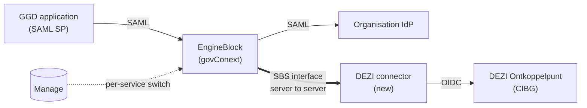
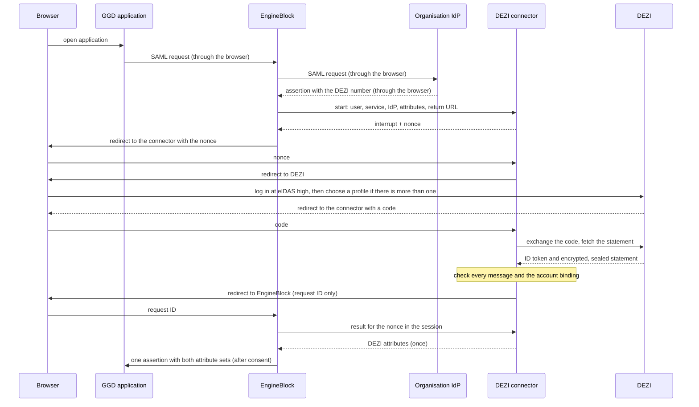
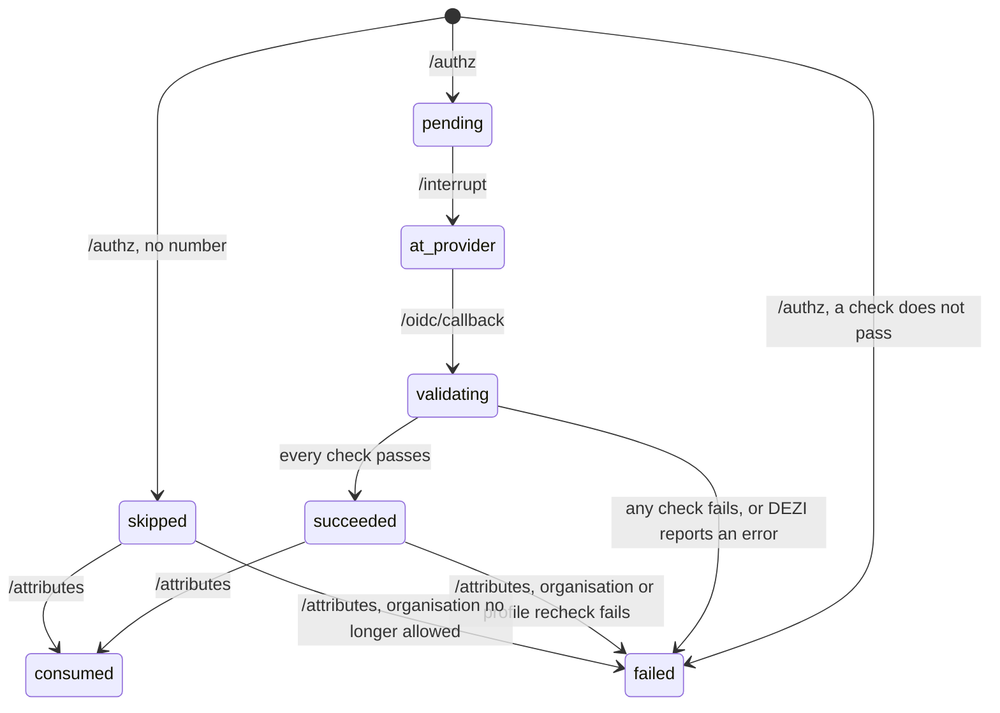

# DEZI connector for EngineBlock — high-level design

**Status:** draft for review

**Published:** 5 October 2026

**Last updated:** 12 October 2026

**Authors:** Dawn Technology (M. Roest, J. Kromhout), Govroam (Erik Dobbelsteijn), SURF (Bas Zoetekouw)

---

## Document history

| Date | Change |
| --- | --- |
| 5 October 2026 | First draft of the high-level design. |
| 12 October 2026 | Added the optional DEZI step. An account without a DEZI number skips DEZI and logs in at the organisation's level, marked by the login flag `skipped` (`verified` after a DEZI login). The organisation check runs before the skip decision. New application contract and tests for both paths (§1, §3, §4, §6, §7, §9, §13, §18, §20). |
| 12 October 2026 | Structure and checks. The connector is split into core, OIDC client and DEZI profile, with a claim mapping, startup checks, an operator checklist and tests on the real configuration (§2, §14, §16–§18). |
| 12 October 2026 | Revocation. The live status check is the primary mechanism and the list is optional. A `404` or other 4xx refuses the login, and the list never covers it. The status URL comes from a configured template. No assumption about statement age (§10, §11, §15–§18, evidence). |
| 12 October 2026 | DEZI's keys and messages. Approved key addresses and expected issuers per message type, including the ID token. A cache rule for keys and metadata. Discovery and redirects restricted to the matching message type. `00.000` released like any other role code. Every attempt is a fresh DEZI login (§6, §7, §10, §14, §16–§18). |
| 12 October 2026 | The connector's own keys. Several decryption keys with a replacement order and an expiry alert. Signed client authentication at the token endpoint (`private_key_jwt`, `RS256`) with a signing key per client (§2, §3, §5, §10, §14, §16–§20, evidence). |
| 12 October 2026 | Organisation policy. The approved connector organisation list is the policy source, with versions and rules for change, withdrawal, rollout and rollback. The policy is checked again at result delivery. The trusted-proxy contract is corrected (§5, §7–§9, §12, §13, §17, §18, evidence). |
| 12 October 2026 | Binding attribute. No IdP manipulation and no aggregation source sets, changes or removes it (§4, §10, §17, §18). |
| 12 October 2026 | EngineBlock interface. Two API token headers, EngineBlock's call timeout, a non-empty nonce in every `interrupt` answer, a start request limited to the fields the connector uses, and a restart link only for failures that a new attempt can fix (§9, §12, §13, §17, §18, §20, evidence). |
| 12 October 2026 | Dependencies and scope. The required EngineBlock and Manage versions are stated once, in §10. The repository is in the OpenConext GitHub organisation, and govroam chooses its name. The connector offers no fallback for an unreachable DEZI. New and reworded CIBG questions (§1, §10, §11). |
| 12 October 2026 | Audit and sessions. An explicit audit, correlation and retention decision, and role, session and logging contracts for the applications, before production (§7, §10, §11, §20). |
| 12 October 2026 | Corrections. "Organisation" replaces "institution". Source references and evidence corrected. The govroam deck reference is removed. The message-mixing row is restated (§1, §5, §9, §16, §19, evidence). |
| 19 October 2026 | The transaction state `at_dezi` is renamed `at_provider`, because the core names no provider (§2, §13, §14). |

---

GGD GHOR applications on govConext need a healthcare worker's DEZI identity next to the attributes
the worker's own organisation already sends. This design adds a separate service, the **DEZI
connector**, that EngineBlock calls through the interface it already uses for SBS. The connector runs
the OpenID Connect (OIDC) login at DEZI, checks that the DEZI identity belongs to the person who
logged in at the organisation, and hands the DEZI attributes back to EngineBlock. For an account
without a DEZI number, the DEZI step is skipped (§4). EngineBlock gets no OIDC code. With the
configuration in §17, the proof of concept needs no EngineBlock code change.

Part 1 describes how the integration works and what each party must provide. Part 2 holds the
contracts and implementation details. The code and specification references are at the end.

---

## Part 1 — How it works

## 1. Purpose and scope

The connector **enriches a login with attributes from DEZI**. While the integration is on for a
service, a login from an account with a DEZI number passes through DEZI at eIDAS level high. The
service receives the DEZI number, the subscriber (the care organisation) and, when the profile has
one, the role, next to the organisation attributes. An application grants DEZI-based access only when
these attributes are present and meet its own access rules (§7).

For an account without a DEZI number, the connector skips the DEZI step (§4). The login still takes
place: the service receives the organisation attributes and the login flag `skipped`, and no DEZI
attributes. That login has the organisation's level of assurance and no eIDAS high. The application
decides what such a login may do (§7). The skip serves users who do not have a DEZI number yet
during the transition to DEZI registration, and users such as administrators who do not need one. An
account with a DEZI number always goes through DEZI, and a failure there stops the login.

The connector does not:

- **raise the level of assurance in the SAML assertion.** The SBS interface has no field for it. The
  assertion keeps the organisation's authentication context.
- **replace the organisation login.** The organisation IdP stays the first step.
- **offer a fallback when DEZI cannot be reached.** The login of an account with a DEZI number stops
  while DEZI is unreachable. Any alternative route is outside this design.
- **decide clinical access, decide what a login without DEZI may do, or keep audit logs for the
  applications.** All three stay with the applications.

The organisations, the federation, the connector and the applications share the responsibility for
identification and authentication. A compliance review allocates that responsibility before
production (§11).

## 2. Components



| Component | Role in this design | What changes |
| --- | --- | --- |
| GGD application | Applies its own authorization to logins with and without DEZI attributes, including subscriber and role rules | Implements the acceptance contract (§7) |
| EngineBlock | SAML proxy. Calls the connector for every service that has the SBS switch on, and merges the attributes it gets back | Configuration only, on the release in §10 |
| Manage | Holds the per-service switch `coin:collab_enabled`, release policies and EngineBlock's organisation connection settings | Settings per DEZI service (§17), on the version in §10 |
| DEZI connector | Implements EngineBlock's SBS interface on one side and acts as OIDC client to DEZI on the other. Skips the DEZI step for an account without a DEZI number | New service |
| DEZI Ontkoppelpunt | OIDC provider run by the CIBG. Returns a signed statement with the DEZI number, subscriber and role | Nothing |
| Organisation IdP | Logs the user in and sends the account's DEZI number, when the account has one | Releases one extra attribute, provisioned under a contract (§4) |

**Inside the connector.** Three parts, of which only the DEZI profile holds DEZI-specific code:

| Part | Responsibility | DEZI-specific |
| --- | --- | --- |
| Core | EngineBlock interface (§12), transactions and organisation checks (§13), account binding (§4), skip, claim mapping and release (§17), login flag and reserved names (§6), logging (§20) | No. Names come from the configuration |
| OIDC client | Authorisation request with PKCE, `state` and `nonce`, token exchange with a signed client assertion, ID token validation (§14: token request, callback, token response, ID token) | No. Standard OIDC, with parameters from the configuration |
| DEZI profile | Decryption of the UserInfo response, validation of envelope and statement, revocation, DEZI formats (§14–§16) | Yes |

The profile hands the core a verified claim set (claim name to string values), the hard expiry of
the proof, and a recheck that runs when the result is delivered. For DEZI, the hard expiry covers the
envelope and statement; the revocation decision has a separate, renewable validity time (§15).
Renewing that decision never extends the hard expiry. The core knows no DEZI
claim name: the claim mapping in §17 names every claim, attribute and rule. A different provider
would add a profile and a `provider` block in the configuration. The account binding is on for every
service. The configuration names the claim that is compared and has no setting that turns the
comparison off.

## 3. The login, step by step



1. **Organisation login.** The user opens the application. The SP sends the user to EngineBlock, and
   EngineBlock sends the user to the organisation IdP. The IdP returns its attributes, including the
   account's DEZI number.
2. **Start.** The service has the switch on, so EngineBlock calls the connector server to server. It
   sends the user identifier, the service, the IdP, the organisation attributes and a return URL.
3. **Interrupt.** The connector opens a transaction and answers "interrupt" with a one-time code, the
   nonce. EngineBlock keeps the nonce in the user's session and sends the browser to the connector
   with it.
4. **DEZI login.** The connector sends the browser to DEZI. The user logs in with an eIDAS-high
   means. DEZI asks for a new login on every attempt, also when the user logged in at DEZI a minute
   earlier (§14). When the user has more than one profile, DEZI then asks which one to use. DEZI returns the
   browser to the connector with an authorisation code.
5. **Checks.** The connector exchanges the code server to server, signing the request with its own
   key, and receives DEZI's encrypted, sealed statement. It checks every message, the revocation status and the account binding (§4,
   §14, §15). It then sends the browser back to EngineBlock's return URL. That URL carries only the
   SAML request ID.
6. **Result.** EngineBlock reads the nonce from its own session and asks the connector for the
   result, server to server. The connector returns the attributes and the login flag `verified` once,
   if they are still valid, and closes the transaction.
7. **On to the service.** EngineBlock adds the attributes, shows consent and sends one assertion to
   the SP with both the organisation attributes and the DEZI attributes.

Steps 1 and 7 work today. Steps 2, 3 and 6 use EngineBlock's existing SBS behaviour. Steps 4 and 5
are the connector.

**Without a DEZI number.** When the account has no DEZI number (§4), steps 4 and 5 do not take
place:

1. **Start.** As step 2. The connector checks the organisation, finds no number, marks the
   transaction `skipped` and answers "interrupt" with a nonce.
2. **Hand-off.** EngineBlock sends the browser to the connector with the nonce. The connector sends
   the browser straight back to EngineBlock's return URL. The user sees no DEZI page.
3. **Result.** As step 6. The connector returns one attribute, the login flag with the value
   `skipped`.
4. **On to the service.** As step 7. The assertion holds the organisation attributes and the flag. It
   holds no DEZI attributes and no eIDAS high.

## 4. Binding the DEZI login to the organisation account

Without a check, the DEZI attributes could belong to a different person than the one who logged in
at the organisation. The connector closes that gap with the DEZI number.

- DEZI's statement carries `dezi_nummer`, the worker's number in the DEZI register. The
  configuration names this claim as the binding claim (§17).
- The organisation IdP sends the account's DEZI number in the binding attribute. EngineBlock passes it
  to the connector in the start call, before its release rules run, so the application does not need
  to receive it.
- When the binding attribute holds exactly one non-empty string value, the connector compares that
  value with `dezi_nummer` as an exact string, in the format the CIBG confirms. It returns
  attributes only when the two are equal.

The same check blocks a swap. Suppose an attacker sends a victim the connector link of the attacker's
own pending login, and the victim completes DEZI. The victim's DEZI number then differs from the
number on the attacker's organisation account, and the connector refuses the result.

**No number.** The connector decides on the binding attribute as the start call carries it:

| Binding attribute | Result |
| --- | --- |
| Absent, an empty list, or one empty string | Transaction `skipped` |
| Exactly one non-empty string | DEZI login and binding check |
| Anything else, such as several values or a value of only spaces | Transaction `failed` |

Only the organisation's attribute decides; input from the browser never does. When the account has a
number, a number mismatch, a DEZI error or a cancel fails the transaction and stops the login. It
never becomes a skip.

EngineBlock leaves an attribute with a non-string value out of the start call (§12), so an
integer-typed number reaches the connector as absent. That is a skip. The organisation sends the
number as a string.

The SAML parser also trims string values. A raw SAML value of only spaces reaches the start call as
one empty string and is therefore skipped. A value of only spaces introduced after parsing, for
example by an IdP manipulation, still fails the connector's check. The connector cannot recover the
original value. If the organisation requires malformed raw values to stop the login, it must check
them before this information is lost. The tests distinguish the SAML and connector boundaries (§18).

The binding holds only as far as the organisation's mapping holds. GGD GHOR supplies a provisioning
contract (§10) that states:

- the authoritative source of the DEZI number;
- how the number is verified to belong to the account holder;
- that the user cannot change it;
- how reassignment, corrections and offboarding remove or replace it;
- that each account carries at most one number.

The start call carries the binding attribute after IdP attribute manipulation and attribute
aggregation (§12). A manipulation or an aggregation source that sets, changes or removes this
attribute replaces the organisation's statement. A set or changed value is one the organisation did
not send. A removed value makes an account with a number look like one without, so the connector
skips DEZI. The operator checklist forbids all three (§17, check 17).

The comparison binds the DEZI result to the account. It does not raise the assurance of the
organisation's other attributes, and the assertion does not claim eIDAS high for the organisation
identity. A service reads the DEZI attributes as DEZI's statement about the person behind this
account.

## 5. Trust boundaries

| Boundary | How it is protected |
| --- | --- |
| **EngineBlock ↔ connector** | Both run inside govConext under the same operator. Calls go over TLS with an API token. Everything that matters travels server to server. EngineBlock takes the nonce from its own session, never from the browser. This is the setting the SBS exchange is built for |
| **Connector ↔ DEZI** | DEZI is external, so the connector uses PKCE, a signed client assertion at the token endpoint, a `state` tied to the transaction's browser cookie, a `nonce`, a signed authentication time, message signatures, decryption with its own key, matching statement identifiers and a revocation decision (§14, §15). The subject binding between the ID token and UserInfo is an acceptance dependency: exact `sub` equality where supplied, or the explicitly approved DEZI-specific association and its limits |
| **Browser** | Carries the nonce to the connector, the authorisation code from DEZI, and the request ID back to EngineBlock. Neither EngineBlock nor the connector accepts a result, identifier or level from the browser |
| **Attribute origin** | Values under the reserved DEZI attribute names reach a service only from the connector. Configuration keeps organisation values out of that namespace, and the login flag exposes a forged value to the application (§6, §17) |

What an attacker can try, and what stops it:

| Attempt | What stops it |
| --- | --- |
| Reuse a nonce, a `state` or an authorisation code | All are single use and expire after minutes |
| Forge `state` | The connector compares it with the stored value and the transaction's browser cookie |
| Complete DEZI as someone else | Account binding (§4) |
| Present an earlier DEZI authentication | The signed authentication time must fall after the start of this attempt (§14) |
| Combine messages from different logins | The connector redeems one authorisation code, with PKCE, and calls UserInfo itself with the access token of that token response. Envelope and statement carry the same `verklaring_id`, and the revocation check uses it (§14, §15). That the UserInfo belongs to the ID token's subject rests on DEZI, because version 0.7 has no envelope `sub` (§14, §10) |
| Send values under DEZI attribute names from the organisation | The release policy and manipulation rules keep the reserved namespace free of organisation values (§6) |
| Skip DEZI although the account has a number | Only the organisation's attribute decides. An account with a number always goes to DEZI, and a DEZI failure fails the login (§4) |
| Reach the service from an organisation that is not allowed | The connector checks the current organisation policy before the skip decision and again at result delivery. A trusted-proxy route also keeps the Manage check (§8, §13) |
| Present forged DEZI attributes on a skipped login | A start-visible reserved name fails the transaction; the required release policy removes values hidden from the start call. The application also refuses an assertion carrying both `verified` and `skipped` if a configuration guardrail regresses (§6, §7) |
| Collect a result twice | The connector consumes a result once, in one atomic step (§13) |
| Send EngineBlock a forged result | EngineBlock only takes results from its own server-to-server call |
| Change the return URL | The connector takes the return URL from the start call and accepts only EngineBlock's own URL |
| Point the connector at a fake key | The connector only uses keys from a fixed list of DEZI addresses |

## 6. What the service receives, and where it comes from

| Attribute | Source | Released |
| --- | --- | --- |
| Organisation attributes | Organisation IdP, filtered by the service's release policy | As today |
| DEZI number | `dezi_nummer` in DEZI's statement | Per service, default on |
| Subscriber number (care organisation) | `abonnee_nummer` | Per service, default on |
| Role code | `rol_code`, when the profile has one | Per service, default on |
| Role name, subscriber name, name parts | `rol_naam`, `abonnee_naam`, `voorletters`, `voorvoegsel`, `achternaam` | Per service, default off |
| Login flag | Set by the connector: `verified` after a DEZI login, `skipped` when the DEZI step is skipped | Always |

One login gives one profile. The statement holds one subscriber and at most one role. When the
profile has no role code, the connector releases no role attribute. It never fills in a role. A role
code that is present, including `00.000`, is released as DEZI sends it. The connector gives no code
a special meaning.

**The reserved namespace.** All DEZI attribute names share one namespace,
`urn:mace:govroam.nl:attribute-def:dezi:`, a placeholder until govroam agrees the names with the
services. The namespace is the configuration value `attributes.reserved_prefix` (§17). Values
under these names reach a service only from the connector. EngineBlock does not
enforce this by itself:

- The start request leaves out any attribute with a non-string value. An organisation value such as
  `["untrusted-value", 1]` under a reserved name therefore never reaches the connector.
- On the return, EngineBlock merges the connector's values with any value still present under the
  same name.
- Attribute manipulations and `release_as` rules can write into any name.

Configuration carries the protection (§17):

- every DEZI service has an explicit release policy that lists no reserved name;
- no manipulation or `release_as` rule writes into the namespace;
- both stay in place when the integration is off.

A regression test proves the protection on the actual operator configuration (§18). If the
configuration cannot prove it, EngineBlock needs a bounded change at the merge (§9, item 4).

**The login flag.** The connector returns the flag `urn:mace:govroam.nl:attribute-def:dezi:login` on
every result: `verified` after a DEZI login, `skipped` when the DEZI step is skipped. The flag is
part of the reserved namespace. EngineBlock merges the connector's value with any value already
present under the same name and removes duplicates. Under the required configuration, an
organisation's reserved value is rejected at the start or removed before this merge. If a
configuration guardrail regresses and an organisation value `verified` survives on a skipped login,
the merge produces both `verified` and `skipped`. The application refuses that assertion and requires
exactly one value `verified` before it reads any DEZI attribute (§7).

The binding attribute, `urn:mace:govroam.nl:attribute-def:organisation-dezi-nummer`, sits outside the
reserved namespace. It is the organisation's statement, not DEZI's.

The service does not receive DEZI's sealed statement itself (§10), or DEZI's level in the
assertion's authentication context. On a skipped login the assertion holds no DEZI attributes, and
the flag `skipped` is the only sign of the skip.

## 7. Application acceptance contract

An application that uses the DEZI attributes:

1. validates the signature and issuer of govConext's assertion;
2. reads the login flag and requires exactly one value. The value `verified` means the DEZI
   attributes can be used. The value `skipped`, or no flag, means a login without DEZI. Any other
   value, or more than one value, is refused;
3. on `verified`, requires exactly one non-empty DEZI number and exactly one non-empty subscriber
   number from the reserved namespace, and refuses a login with more than one value for either;
4. when it uses a role code for authorization, requires exactly one non-empty string value and
   refuses malformed or multiple values. A missing role is refused when its rules need one, and
   never becomes a default role or an implicit permission. A role code that is present grants nothing
   until the application matches it against its own list of permitted roles, `00.000` included;
5. applies its own rules on permitted subscribers and roles;
6. grants DEZI-based access only on `verified`, with every required DEZI attribute present and
   within these rules;
7. applies its own authorization rules to a login without DEZI. These rules are agreed with govroam
   and written down per application;
8. enforces the application owner's approved inactivity timeout and absolute lifetime for
   DEZI-based sessions. Reauthentication goes through govConext and a new DEZI check. The owner
   states the maximum acceptable delay between a DEZI revocation and loss of application access.
   If periodic reauthentication cannot meet it, the owner must provide and test a separate
   revocation or session-invalidation mechanism before onboarding.

The application never infers a DEZI result from the organisation's DEZI-number attribute, from the
assertion's authentication context or from the switch in Manage. A login without DEZI has the
organisation's level of assurance and no eIDAS high. The contract relies on the namespace protection
in §6.

The connector checks revocation at login and delivery, not throughout an application session.
Neither the login flag nor the SAML assertion promises continuous revocation checking. Statement
expiry is not sent under the current attribute contract. An application that requires expiry to
bound its session must agree and test how it obtains or enforces that bound before onboarding.

Withdrawing an organisation's connection stops new connector transactions and pending result
delivery once the approved change is effective (§8). It does not invalidate an existing application
session. The application owner must state and test what happens to those sessions under the agreed
connection policy.

**Onboarding check.** Before a service goes live:

- The connector's release set for the service, `sram.allowed_attributes` and the application's
  required set match. Both configurations deliver every required name and the login flag.
- The application grants no DEZI-based access with the integration switched off, with the flag
  `skipped`, and with the flag removed.
- The application grants no DEZI-based access with one required name removed from
  `sram.allowed_attributes`.
- The real EngineBlock path rejects or filters forged organisation values under reserved names.
  A separate application test supplies a validly signed test assertion with both `verified` and
  `skipped`, and forged DEZI attributes, and proves that the application refuses it.
- A verified test assertion with valid number and subscriber attributes but two role codes,
  including an otherwise permitted privileged role, is refused when the application uses roles.
- A login without DEZI gets exactly the access that the application's agreed rules give.
- The owner has approved the session limits and revocation delay. Tests show that access stops at
  the agreed limits, that reauthentication makes a new DEZI check, and that a revocation after login
  takes effect within the agreed delay. A withdrawal of the organisation connection follows the
  owner's approved rules for existing application sessions.

These results are shown with the real access decision of the application. A test page that only
displays attributes does not prove them.

## 8. Switching it on per service

| Where | Setting |
| --- | --- |
| EngineBlock | Feature `feature_enable_sram_interrupt` on. The `sram.*` parameters point at the connector. `sram.allowed_attributes` lists the reserved DEZI names and the login flag |
| Manage | `coin:collab_enabled` on for each DEZI service, and an explicit release policy without reserved names |
| Connector | Per service: the organisations that may use it, the DEZI attributes to release, the DEZI client registration, and the restart-login URL the application owner approves |

**Organisation connection policy.** The connector configuration is the source for the approved
organisation set of each DEZI service. govroam and the application owner approve its contents and
changes in a dated, versioned decision. Prolocation applies the change and proves that the active
settings enforce that set. The connector does not import its policy from Manage, and changing
Manage alone does not change the connector's policy.

On a direct SBS-enabled service, EngineBlock skips its own connection check. For a trusted-proxy
route, the supported configuration keeps `coin:collab_enabled` off on the immediate proxy and on
for the requesting DEZI service. EngineBlock then checks that service's Manage connection policy
before calling the connector. Prolocation keeps that Manage policy equal to the approved connector
set. It must not turn SBS on for the proxy merely to bypass the extra check: that also changes
connection checks for other requesters.

The approval records the effective time and maximum rollout delay for additions and withdrawals.
Prolocation updates every serving connector node and, where applicable, Manage, and drains calls
using the old policy before declaring a change effective. A partial rollout is not a completed
withdrawal. The connector checks the current policy at result delivery, including transactions
started under an older version (§13). Tests cover a withdrawal with such a transaction still open.
Policy rollback needs the same approval as any other change.

Switching `coin:collab_enabled` off disables the integration for that service. DEZI-based access
then stays unavailable, because the login flag is missing (§7). Any other way in is a separate
route, approved by the application owner and documented with its own level of assurance.

The operator checklist in §17 lists every setting that must hold.

## 9. Limits of the current interface, and how they are handled

EngineBlock's SBS interface was built for SBS. Used for DEZI without changes, it has these limits.

| # | Limit in EngineBlock today | How it is handled |
| --- | --- | --- |
| 1 | EngineBlock talks to one SBS server | govConext does not use SRAM, so the connector takes that place. Running SRAM next to the connector would need an EngineBlock change: more than one connector per EngineBlock |
| 2 | The start call carries the organisation attributes only in some EngineBlock releases, and a greater version label does not guarantee it | govConext runs a release that includes them, as §10 states. The proof of concept pins that release |
| 3 | EngineBlock checks the immediate service's SBS switch before resolving a trusted proxy's requester; the SBS filter resolves the requester first | The approved connector policy is the source (§8). Direct SBS-enabled services use the connector check; the supported proxy configuration also keeps the requesting service's Manage check. Both enforce the same approved set (§17) |
| 4 | Attributes added on the return skip the release policy and merge with values already present under the same name. The start call leaves out attributes with a non-string value | The reserved namespace is protected by configuration and proven by a regression test (§6, §17, §18). If the configuration cannot prove it, EngineBlock needs a bounded change at the merge |
| 5 | An empty result lets the login continue without DEZI attributes | The connector answers with an HTTP error when the DEZI step did not succeed, never with an empty result. A deliberate skip returns the login flag `skipped`. The connector never answers "authorized": EngineBlock rejects it without attributes |
| 6 | The assertion keeps the organisation's authentication context | The application contract does not use the assertion's level for DEZI decisions (§7) |
| 7 | The policy engine runs before the return, so it cannot require DEZI attributes | The application makes the access decision (§7) |
| 8 | `sram.allowed_attributes` is global and drops names that are not on it without stopping the login | The onboarding check compares it with the release set and the required set (§7) |
| 9 | Every failed call ends on EngineBlock's generic error page | The connector shows its own page for failures it can explain, with a link to restart the login when a new attempt can succeed (§13) |
| 10 | After Stepup, EngineBlock sends the browser to the connector without the nonce. Stepup has four triggers: the service's metadata, the organisation's Stepup setting for the service, a policy, and a Stepup level in the service's own login request | DEZI services keep all four empty (§17). An application that must request a Stepup level needs the EngineBlock fix that carries the stored nonce into the hand-off |
| 11 | A login without DEZI attributes reaches the application as a normal login | The application decides (§7). The login flag exposes forged DEZI attributes (§6) |
| 12 | EngineBlock accepts an `interrupt` answer with an empty nonce and then continues without the connector, with no error | The connector never answers `interrupt` without a non-empty nonce (§12, §13) |
| 13 | EngineBlock gives each call to the connector `http_client.timeout` seconds in total, 10 by default | The result call makes at most one outgoing request, and `revocation.timeout_seconds` stays within half of EngineBlock's timeout (§13, §17) |
| 14 | EngineBlock sends the API token in two headers, `Authorization` and `Authentication` | The connector reads `Authorization`. Logs and proxies redact both headers (§12, §20) |
| 15 | The start call carries all organisation attributes, before the release policy has removed any | The connector keeps and logs only the fields it uses. Sending fewer attributes needs an EngineBlock change (§12, §20) |

## 10. Dependencies and decisions with external owners

Every answer is written down, with who gave it and the setting or test it leads to. A confirmed row
must link to a dated decision record and its approver before it can satisfy a deployment gate. The
status column shows whether an item is open or confirmed.

| Owner | What is needed | Needed before | Status |
| --- | --- | --- | --- |
| Prolocation, govroam | Confirmation that govConext does not use SRAM. EngineBlock can connect to only one service of this kind, and the connector takes that place | Acceptance deployment | Confirmed |
| Prolocation | Confirmation that govConext runs EngineBlock 7.2.1 or another release containing the same start-request fields. A greater version label alone is insufficient: 7.3.0-beta3 lacks the organisation attributes | Acceptance deployment | Confirmed; govConext moves to 7.2.1 |
| Prolocation | Confirmation that govConext runs Manage 9.1.0 or later, the first release with the `coin:collab_enabled` setting that switches the connector on per service | Acceptance deployment | Open |
| Prolocation, govroam | Agreement that the connector runs inside govConext, managed by the team that runs EngineBlock | Acceptance deployment | Confirmed |
| Prolocation, govroam | The real settings of each DEZI service: which organisation attributes it receives, every IdP manipulation of the allowed organisations, every attribute aggregation source, and every rule that renames or changes attributes. Also whether `feature_run_all_manipulations_prior_to_consent` is on. These settings decide whether an organisation can slip a value in under a DEZI attribute name (§6) and whether anything other than the organisation IdP sets, changes or removes the binding attribute (§4) | Acceptance deployment | Open |
| govroam, application owners, Prolocation | A dated, versioned approval of each service's connector organisation list; who approves changes and withdrawals; the effective time and maximum rollout delay; the direct or proxy route and any matching Manage policy; and real-configuration tests of allowed, refused and withdrawn connections (§8, §17, §18) | Acceptance deployment and onboarding each application | Open |
| Prolocation | A database that all connector servers use, so a login can continue on any server. It must support "update this record only if it is still in this state" as one operation. Then a request that arrives twice is handled once, and a DEZI result is handed out only once (§13) | Acceptance deployment | Open |
| Prolocation | Server clocks kept in sync, time limits on outgoing calls, EngineBlock's `http_client.timeout` stated (10 seconds by default) and entered as `engineblock.call_timeout_seconds` (§13, §17), and TLS 1.3 for all traffic to DEZI, as DEZI requires | Acceptance deployment | Open |
| Prolocation | A separate log identifier; redaction of live nonces, codes, tokens, cookies and the `Authorization` and `Authentication` headers from application, proxy and tracing logs; and tested correlation between the connector's EngineBlock request ID and the application's assertion or request ID (§20) | Acceptance deployment | Open |
| GGD GHOR | A short description of how each organisation account gets its DEZI number: where the number comes from, how it is checked to belong to that person, who may change it, and what happens when someone changes jobs or leaves (§4) | Acceptance deployment | Open |
| GGD GHOR | Organisation IdPs that send the DEZI number as a string for accounts that have one, under the attribute name agreed with govroam | Acceptance deployment | Open |
| GGD GHOR, CIBG | A DEZI client registration for the connector. The form asks for the connector's return address and a public certificate in PEM format. DEZI uses that certificate to encrypt its answers. The form has no field for a signing certificate (next two rows) | Manual test against DEZI acceptance | Open |
| CIBG | Whether DEZI accepts `private_key_jwt` and how a client registers its signing key. The connector authenticates at the token endpoint with `private_key_jwt` (§14, §17: `provider.clients.<id>.authentication` and `signing_key`). The specification lists only `none` (p12) and shows a token request without a client assertion (p15). Acceptance discovery lists `none` and `private_key_jwt`. Form DEZI01.1 takes one public certificate, for encryption, and the specification allows one certificate per system (p16). Needed: whether acceptance and production accept, require or refuse `private_key_jwt` for a registered client (when refused, the client configures `authentication: none`); how the public key is registered: a second certificate, an address with a key set, or the one certificate for both purposes; and whether acceptance and production differ | Manual test against DEZI acceptance | Open |
| CIBG | What the client assertion must contain. The connector builds it as §14 describes: `RS256`; `iss` and `sub` equal to the client ID; `aud` equal to the `token_endpoint` of the discovery metadata; `iat`; `exp` `assertion_lifetime_seconds` after `iat` (§17, 60 seconds in the sample); a random `jti` for every request; header `kid` when configured, and `x5t#S256`. Needed: confirmation of each value, or the values DEZI requires. This includes the algorithm, the `aud` (the token endpoint or the issuer), the longest lifetime, the header that selects the key, whether a repeated `jti` is refused, and how much clock difference DEZI tolerates | Manual test against DEZI acceptance | Open |
| CIBG | The final version of the specification, or the newest draft when there is no final version, and confirmation that the acceptance environment follows it. Version 0.7 is a concept. The next four CIBG rows (example messages, login age, the revocation list and the exact formats) are expected to be answered by the final specification | Acceptance deployment | Open |
| CIBG | Example messages that match the real DEZI service, for every step of the login. They show how the user details are tied to the same user as the login token, which key address signs each message type in `provider.approved_key_addresses`, and which issuer and audience values each message carries. This includes the `iss` of the ID token on acceptance, where discovery names `https://acceptatie.auth.dezi.nl` and the revocation list carries `https://auth.dezi.nl` | Acceptance deployment | Open |
| CIBG | How recent a DEZI login must be. Does DEZI support `max_age` and always return `auth_time`? How old may a login be, and how far may clocks differ? | Acceptance deployment | Open |
| CIBG | Whether the status check per statement is sufficient on its own for a login, without assuming that a fresh login produces a newly issued register statement. Which status values exist besides `actief`, and what a statement removed from the register answers: `404` or another status. When the list is also needed: what the refresh time in the revocation list (`ververs_tijdstip`) means, which the specification defines as the moment within which the list must be refreshed without saying by whom, and whether and for how long the connector may use a list after that time | Acceptance deployment | Open |
| CIBG | The exact formats. The specification shows different versions of the value for eIDAS high, the revocation field names and addresses, the timestamps and the role codes. It also needs to show what a profile without a role code looks like | Acceptance deployment | Open |
| CIBG, GGD GHOR | Whether one connector registration may serve several applications and care organisations | Production entry | Open |
| CIBG | How the client's certificates are replaced, the decryption certificate and the signing certificate: the lead time to register a new certificate, whether two certificates may be active during the change, and whether DEZI checks the validity period of the certificate (§14) | Production entry | Open |
| govroam, GGD GHOR | Permission for the connector to decrypt DEZI's answers and pass the details on to the applications, with a legal basis for that | Production entry | Confirmed by govroam |
| CIBG, GGD GHOR | Whether the connector may also pass on DEZI's signed statement itself, so the application can check DEZI's seal. DEZI has not yet published its terms of connection | Production entry | Open |
| Application owners | The DEZI attributes the application needs, whether it needs a role, and its own rules on which care organisations and roles get access | Onboarding the application | Open |
| Application owners | Confirmation that the application does not ask for a Stepup level in its login request. After Stepup, EngineBlock loses track of the connector's transaction (§9, item 10) | Onboarding the application | Open |
| Application owners | A login address the connector can send users to when they need to start again | Onboarding the application | Open |
| Application owners | A test with the real application that shows it grants no DEZI-based access when the login flag is not `verified` or the DEZI attributes are missing | Onboarding the application | Open |
| Application owners | Approved inactivity timeout, absolute DEZI-session lifetime and maximum revocation delay; treatment of existing sessions after an organisation connection is withdrawn; any needed expiry or session-invalidation mechanism; and tests of role cardinality, session limits, reauthentication and revocation after login (§7) | Onboarding the application | Open |
| Application owners, govroam | The authorization rules of each application for a login without DEZI attributes: which users keep access during the transition and what an administrator may do. Agreed with govroam and written down | Onboarding the application | Open |
| govroam, Prolocation, application owners | A completed, approved allocation of identification, authentication and audit duties, including whether a statement-to-login reference is required, how it is resolved in an investigation, log and transaction retention, access controls and accepted risks (§20) | Production entry | Open |
| govroam | The reserved name space for DEZI attributes and the exact attribute names, including the login flag, agreed with the applications | Acceptance deployment | Open |
| SURF | Is it acceptable that the assertion keeps the organisation's login level, so the login flag and the DEZI attributes are the only sign of the DEZI login? If not, EngineBlock needs a change that puts DEZI's level in the assertion | Acceptance deployment | Open |
| SURF | If govConext's settings cannot keep organisation values out of the DEZI attribute names, may EngineBlock change so that the connector's values replace any value under those names? (§6) | Acceptance deployment | Open |
| SURF | If an application must ask for a Stepup level in its login request, may EngineBlock get the fix that keeps the connector's nonce after Stepup? See the [bug report](../Issues/2026-10-05-engineblock-sbs-interrupt-after-stepup-empty-nonce.md) | Acceptance deployment | Open |
| govroam | The name of the connector's repository in the OpenConext GitHub organisation (§11) | Acceptance deployment | Open |

## 11. Delivery and ownership

| | Proof of concept | Acceptance deployment | Production entry |
| --- | --- | --- | --- |
| Runs on | OpenConext-devconf, with the EngineBlock release from §10 mounted through devconf's development override | govConext acceptance | govConext production |
| DEZI | A mock built from DEZI's specification and the confirmed fixtures. A manual test against DEZI acceptance once the client is registered | DEZI acceptance, with fictitious data only. DEZI's test environment is not meant for systems with real patient data | DEZI production |
| Shows | The full login, the skip, the account binding, the namespace protection and every failure path, in automated tests | A production-grade connector: shared store, key rotation, the optional revocation list, monitoring and deployment artefacts, with test instances of the GGD applications | — |
| Gate | — | The dependencies marked "acceptance deployment" in §10, with their decision records and tests | An approved DEZI client registration and environment; CIBG permission for the connector to act as client for the GGD applications; GGD GHOR's provisioning contract; the acceptance contract, including session and revocation policy, signed off per application; a completed, approved compliance review allocating identification, authentication and audit duties and recording accepted risks (§20) |

The connector keeps the core apart from the DEZI profile (§2). If EngineBlock later offers a
different connector interface, only the EngineBlock part of the core changes.

The connector lives in its own repository in the OpenConext GitHub organisation, under the Apache 2.0
licence like the other OpenConext components. govroam owns it and chooses its name (§10), with Dawn
Technology as developer and maintainer. Moving ownership to SURF later is a separate decision.

---

## Part 2 — Contracts and implementation details

## 12. EngineBlock's SBS interface, as implemented

The connector implements three endpoints. EngineBlock builds their URLs from `sram.base_url` plus a
location parameter.

| Call | EngineBlock parameter | Method | Called by |
| --- | --- | --- | --- |
| Start | `sram.authz_location` | `POST`, JSON | EngineBlock, server to server |
| Browser hand-off | `sram.interrupt_location` | `GET ?nonce=…` | The browser |
| Result | `sram.attributes_location` | `POST`, JSON | EngineBlock, server to server |

Both server-to-server calls carry `Content-Type` and `Accept: application/json` and an
`Authorization` header holding `sram.api_token` as is, without a `Bearer` prefix. EngineBlock's HTTP
client also sends the same token in an `Authentication` header on every call. The connector
authenticates a call with `Authorization` and ignores `Authentication`. Both headers hold the
secret, so every log and proxy redacts both (§20).

EngineBlock limits each call to the connector to `http_client.timeout` seconds in total, 10 by
default. A call that takes longer stops the login on EngineBlock's side, whatever the connector does
afterwards (§13).

**Start request** (EngineBlock → connector):

```json
{
  "user_id": "urn:collab:person:ggd.example.nl:jdoe",
  "eppn": "jdoe@ggd.example.nl",
  "external_subject_id": "",
  "email": ["j.doe@ggd.example.nl"],
  "continue_url": "https://engine.govconext.example/authentication/idp/process-sraminterrupt?ID=_8f3c…",
  "service_id": "https://app.ggd.example.nl/saml/metadata",
  "issuer_id": "https://idp.ggd.example.nl/saml/metadata",
  "attributes": {
    "urn:mace:dir:attribute-def:mail": ["j.doe@ggd.example.nl"],
    "urn:mace:govroam.nl:attribute-def:organisation-dezi-nummer": ["123456789"]
  }
}
```

`attributes` holds the organisation attributes after normalisation, IdP attribute manipulation and
attribute aggregation, and before the release policy. EngineBlock leaves out every attribute that has
a non-string value. A SAML value typed `xs:integer` arrives in EngineBlock as an integer, so one
integer value removes the whole attribute from the start request. The release policy has not run yet,
so the set is wider than what the service may receive. The connector uses `user_id`, `continue_url`,
`service_id`, `issuer_id`, the names of the attributes and the value of the binding attribute. It
ignores `eppn`, `external_subject_id`, `email` and every other value, and stores and logs none of
them (§13, §20). `service_id` is the requesting
service when a trusted proxy supplies a valid requester ID in a signed request; otherwise it is the
immediate service. This service selection does not itself bypass the connection check (§8).

**Start answer** (connector → EngineBlock). The connector answers `interrupt`, or `error` for a
configuration fault such as an unknown service:

```json
{ "msg": "interrupt", "nonce": "q8Zr…", "message": "DEZI_LOGIN_REQUIRED" }
```

EngineBlock logs `message` and ignores it otherwise. For a skipped transaction, `message` is
`DEZI_SKIPPED`. The answer is still `interrupt`: EngineBlock rejects `authorized` without
attributes.

EngineBlock accepts an `interrupt` whose nonce is an empty string. It then treats the login as one
without an interrupt and continues to consent, with no error and without calling the connector
again. The connector therefore never answers `interrupt` without a non-empty nonce. When it cannot
create and store a transaction, it answers `error`, and EngineBlock stops the login.

**Result request and answer:**

```json
{ "nonce": "q8Zr…" }
```

```json
{
  "attributes": {
    "urn:mace:govroam.nl:attribute-def:dezi:login": ["verified"],
    "urn:mace:govroam.nl:attribute-def:dezi:dezi-nummer": ["123456789"],
    "urn:mace:govroam.nl:attribute-def:dezi:abonnee-nummer": ["90000001"],
    "urn:mace:govroam.nl:attribute-def:dezi:rol-code": ["01.000"]
  }
}
```

For a skipped transaction, the answer holds the flag only:

```json
{ "attributes": { "urn:mace:govroam.nl:attribute-def:dezi:login": ["skipped"] } }
```

All attribute names above are placeholders until govroam agrees them with GGD GHOR and the services.

**What EngineBlock does with each answer:**

| Answer | EngineBlock |
| --- | --- |
| Start: `interrupt` with a nonce | Stores the nonce on the response in the session and redirects the browser to `…interrupt?nonce=<nonce>` |
| Start: `authorized` with attributes | Merges them before the release policy and continues without a redirect. The connector never uses this |
| Start: `error`, `authorized` without attributes, invalid JSON, or an HTTP error | Stops the login on `/feedback/unknown-error` |
| Result: `200` with attributes | Keeps the names on `sram.allowed_attributes`, merges them, resets the value types, goes to consent |
| Result: `200` with empty attributes | Goes to consent without DEZI attributes. The connector never uses this |
| Result: `403`, `404`, any other non-2xx, or invalid JSON | Stops the login on `/feedback/unknown-error` |

## 13. Connector transactions

| Endpoint | Purpose |
| --- | --- |
| `POST /authz` | Start. Opens a transaction |
| `GET /interrupt?nonce=` | Hand-off. Starts the DEZI attempt, or sends a skipped transaction back to EngineBlock |
| `GET /oidc/callback` | DEZI's `redirect_uri`. Validates DEZI's answer (§14) |
| `POST /attributes` | Result. Delivers the attributes once |
| `GET /health` | For the operator's monitoring |

**The transaction record:**

| Field | Set by | Content |
| --- | --- | --- |
| Transaction ID | `/authz` | The SBS nonce: random, 256 bits, URL-safe |
| Log ID | `/authz` | A separate random identifier for logging and support; never accepted by an endpoint as a transaction credential |
| Service, organisation, user identifier | `/authz` | From the start request |
| Connection-policy version at start | `/authz` | The approved version used for the organisation check; not an exemption from the current policy at delivery |
| Organisation DEZI number | `/authz` | The one string value of the binding attribute; empty on a skipped transaction |
| Return URL | `/authz` | From the start request; must begin with the configured EngineBlock URL |
| Transaction deadline | `/authz` | Start time plus ten minutes, configurable |
| `state`, OIDC `nonce`, PKCE verifier, cookie value, attempt start time | `/interrupt` | Random values and the current time |
| Attributes and the profile's result data (DEZI: `verklaring_id`, envelope and statement expiry, `auth_time`, revocation decision and its validity) | `/oidc/callback` | Only after every check passes |
| Result deadline | `/oidc/callback`; `/authz` when skipped | The earliest of the transaction deadline and the hard proof expiry the profile reports (DEZI: envelope expiry and statement expiry). Revocation-decision validity is separate and renewable (§15). The transaction deadline when skipped |
| State | Each step | See below |

**States:**



A transaction past its deadline counts as expired, whatever its state. The state names belong to the
core and name no provider: `at_provider` is the state while the user is at DEZI.

**Endpoint behaviour per state:**

| Endpoint | Accepted | Effect | Otherwise |
| --- | --- | --- | --- |
| `POST /authz` | Valid API token, known service | Checks in this order: the current approved policy allows the organisation, the start request carries no reserved name, the binding attribute (§4). Records the policy version. Opens `pending`; `skipped` when the account has no number; or `failed` with a reason when a check does not pass. Answers `interrupt` with the transaction ID as a non-empty nonce, or `error` when it cannot create the transaction | Unknown service: `error` |
| `GET /interrupt` | Known, unexpired `pending` or `skipped` transaction | `pending`: moves it to `at_provider` in one atomic step, sets the transaction's cookie, redirects to DEZI. `skipped`: redirects to the return URL, without DEZI and without a cookie | `at_provider`: a page that the login is in progress; the attempt stays as it is. Unknown, empty, `consumed` or expired: an error page with **Restart login**. `failed`: an error page that follows the failure type (see the rules below) |
| `GET /oidc/callback` | `state` of an `at_provider` transaction, with the matching cookie | Moves it to `validating` in one atomic step, runs §14, then sets `succeeded` or `failed`. On success, redirects to the return URL | Any other state or a mismatch: an error page. A completed transaction never changes |
| `POST /attributes` | Valid API token, before the result deadline, and `succeeded` or `skipped` | Checks the stored service and organisation against the current approved policy. `succeeded`: also runs the profile recheck, renewing an aged revocation decision (§15). Immediately before consumption, checks the current organisation policy again, atomically checks the state and hard deadline, and moves it to `consumed`. Answers `200` with the attributes and `verified`, or the flag `skipped` only | Unknown, `consumed` or expired, including expiry during a recheck: `404`. `pending`, `at_provider`, `validating` or `failed`: `403`. A missing service policy, a withdrawn organisation or a failed profile recheck atomically moves a still-unconsumed `succeeded` or `skipped` transaction to `failed` and returns `403`, without attributes |

**Rules:**

- Every state change is one atomic compare-and-set in the shared store. A read followed by a delete
  does not meet this rule. The proof of concept uses the same operations on one node.
- A failed transaction stays failed. There is no retry inside a transaction. The error page shows the
  log ID. It links to **Restart login**, a login URL the application owner approves for the service,
  only when a new attempt can succeed. The service's entity ID is not a login URL. Every failure
  type is restartable or final:
  - Restartable: the user cancelled at DEZI, DEZI reported an error, the transaction expired, the
    callback's `state` or cookie did not match, or a token request, key fetch or status check got
    no answer (a timeout, an unreachable address, a 5xx answer, a redirect or an invalid body).
  - Final: every other type. These include a refused organisation, a reserved name in the start
    request, a malformed binding attribute, a number mismatch, a failed check on one of DEZI's
    messages, a statement that is not active, and a refused client authentication. The page has no
    restart link. It tells the user to contact support and to quote the log ID.

  A restart repeats the whole login, including the DEZI login (§14). A final failure would give the
  same result every time, so it never offers one.
- A `skipped` transaction moves only to `consumed`, or to `failed` when the current organisation
  policy refuses delivery. It never reaches `validating`.
- The policy version at the start does not grandfather a connection. Delivery uses the current
  approved service policy, not a copy in the transaction. An empty organisation list denies every
  organisation. A missing policy never becomes an unrestricted policy. Rollout and effective-time
  rules in §8 apply to every connector node.
- When the result call consumes a transaction but EngineBlock never receives the answer, the user
  starts a new login. A consumed result is never delivered again.
- EngineBlock gives each call `engineblock.call_timeout_seconds` (§17), the value of its
  `http_client.timeout`. `/authz` makes no outgoing request. `/attributes` makes at most one: the
  renewal of an aged revocation decision (§15), which takes at most `revocation.timeout_seconds`.
  Discovery, key fetches, the list refresh and the first status check happen in the callback or in
  the background, never in a call from EngineBlock. A result that EngineBlock has stopped waiting
  for can still be consumed, and then the rule above for a lost answer applies.
- Renewing a revocation decision never extends the result deadline. A renewed decision must still
  be valid at consumption. Concurrent result calls may recheck, but only one atomic state and
  deadline check can consume the result; another caller cannot change a consumed transaction.
- Each transaction has its own cookie, named after its log ID: `HttpOnly`, `Secure`,
  `SameSite=Lax`, living until the transaction deadline. Finishing a transaction removes only its own
  cookie, so logins in two tabs do not interfere.

## 14. Validating DEZI's answer

**DEZI as advertised** (acceptance discovery, checked 5 October 2026): issuer
`https://acceptatie.auth.dezi.nl`; endpoints `/authorize`, `/token`, `/userinfo` and
`/openid/connect/jwks.json`; code flow only; PKCE `S256`; response mode `query`; scope `openid` only;
subject `pairwise`; ID token signed `RS256`; token endpoint authentication `none` or
`private_key_jwt` (the specification v0.7 example lists `none` only, p12); claims parameter
supported; no logout.

**Authorisation request:** `response_type=code`, `client_id`, `redirect_uri`, `state`, `nonce`, and
`code_challenge` with `code_challenge_method=S256`. The parameters `scope`, `prompt` and `max_age`
come from the configuration (§17): for DEZI `scope=openid`, `prompt=login`, and `max_age=0` once the
CIBG confirms support. The connector records the attempt start time.

Every attempt is a fresh DEZI login. `prompt=login` makes DEZI ignore its own session, and
`max_age=0` asks for an `auth_time` of the present. The connector accepts only an `auth_time` after
the attempt start (ID token row below), so a DEZI session from before the attempt never counts. A
user logs in at DEZI with an eIDAS-high means on every login, and again after every restart.
Accepting an earlier DEZI session needs a different `auth_time` rule and a decision by the CIBG and
the application owners (§10).

**Token request.** The connector authenticates at the token endpoint with `private_key_jwt` (OpenID
Connect Core §9). Acceptance discovery lists the method. The specification v0.7 lists `none` only
(p12) and shows a token request without a client assertion (p15). The CIBG has not confirmed that
DEZI accepts the method for a registered client (§10). The request carries `grant_type`, `code`,
`redirect_uri`, `code_verifier`, `client_id`, `client_assertion_type`
`urn:ietf:params:oauth:client-assertion-type:jwt-bearer` and `client_assertion`.

The assertion is a compact JWS signed `RS256` with the client's signing key (§17). Its claims are:
`iss` and `sub` equal to the client ID; `aud` equal to the `token_endpoint` of the validated
discovery metadata; `iat` the current time; `exp` `assertion_lifetime_seconds` later; and a random
`jti`, new for every request. The header carries the configured `kid`, when there is one, and
`x5t#S256`, the SHA-256 thumbprint of the signing certificate. The connector builds a new assertion
for every token request. It never stores or logs one (§20).

A client configures `authentication: none` only when the CIBG confirms that DEZI wants no client
authentication. The request then holds no assertion. The method comes from the configuration, never
from the discovery metadata, and is never changed after a refusal. When the validated discovery
metadata does not list the configured method in `token_endpoint_auth_methods_supported`, the
transaction fails before the token request. A token endpoint answer other than HTTP 200 fails the
transaction. An `invalid_client` answer has its own failure type.

**Checks per message.** Any failure sets the transaction to `failed`.

| Message | Must hold |
| --- | --- |
| Callback | `state` belongs to an `at_provider` transaction and matches its cookie. No `error` parameter; an error or cancel from DEZI fails the transaction |
| Token response | HTTP 200, `token_type` `Bearer`, an ID token and an access token |
| ID token | `RS256` only, with a key from DEZI's `jwks_uri`, which exactly equals `provider.approved_key_addresses.id_token`. `iss` equals `provider.expected_issuers.id_token`. `aud` contains the registered client ID and no untrusted audience. `azp`, when present, as the agreed client contract says. `sub`, `iat`, `exp` and `auth_time` present. `exp` in the future. `nonce` equals the stored value. `auth_time` no earlier than the attempt start and no later than now, both within the allowed clock skew |
| UserInfo | A JWE with `RSA-OAEP` and `A256CBC-HS512` only, decrypted with one of the registered client's decryption keys (see **The connector's decryption keys**) |
| Envelope | Signature with the key from `provider.approved_key_addresses.envelope`, as confirmed by the CIBG. A supplied `jku` must exactly match that address. `iss` and `aud` as the CIBG confirms for this client registration; `aud` is not assumed to equal the client ID or the SAML service ID. `iat` and `exp` within the validity window. `sub` equal to the ID token's `sub` where supplied. Version 0.7 has no envelope `sub` and says DEZI validates the access token before generating UserInfo (p16); relying on that provider-side association instead requires an explicit CIBG-approved contract and its limits. This is not standard OIDC `sub` equality. `dezi_nummer` never stands in for `sub`. `loa_authn` equals the confirmed high-assurance value. `verklaring_id` present |
| Statement | `RS256` seal, with `jku` exactly equal to `provider.approved_key_addresses.statement` and `kid` selecting a key from that address only. `iss` equals the confirmed statement issuer. `nbf` and `exp` cover the current time. Claim types as confirmed, including the narrow optional-null rule in §16. `verklaring_id` equals the envelope's and is a UUID. `dezi_nummer` and `abonnee_nummer` are non-empty strings. A supplied `rol_code`, unless the confirmed contract explicitly permits null to mean absent, is a non-empty string. `loa_dezi` equals the confirmed high-assurance value |
| Revocation | The same `verklaring_id` is not revoked, by the decision in §15 |
| Account binding | The binding claim (`dezi_nummer`) equals the organisation DEZI number as an exact string (§4) |
| Namespace | Checked at the start call for every transaction, including a skip (§13): the organisation attributes carry no reserved name. This catches only collisions the start request shows; §6 carries the protection |

The rows Callback to ID token belong to the OIDC client, the rows UserInfo to Revocation to the DEZI
profile, and the rows Account binding and Namespace to the core (§2).

Expected values come from the client registration and the approved configuration, never from the
message itself. An open point in DEZI's contract (§10) is a dependency to resolve. It never switches
a check off.

The expected issuer of the ID token is the discovery issuer, unless the CIBG confirms another value.
OpenID Connect expects the two to be equal, so a different value is an exception that the CIBG
approves and §10 records. It is set explicitly in `provider.expected_issuers.id_token` and is never
taken from the token.

**DEZI's keys and metadata.** The configured issuer fixes the discovery address at
`<issuer>/.well-known/openid-configuration`; the returned issuer must equal it. The discovered
`jwks_uri` must exactly equal `provider.approved_key_addresses.id_token`. The configuration names
one approved key address per message type: ID token, envelope, statement and, when enabled,
revocation list (§17). A key address may serve several types only when it is approved for each
type. It never makes the other addresses interchangeable.

The connector fetches keys only from the address configured for the message being checked. A supplied
`jku` must match that address exactly. Redirects to a different address are refused, even when that
address is approved for another message type. Discovery never exempts a key address from this rule.
Cached key sets are kept by address; a `kid` is looked up only in the set for the current message
type, never across all cached sets.

The connector keeps validated metadata and keys for `provider.key_cache_seconds`. An unknown `kid`
triggers one new fetch from that same address, at most once per
`provider.key_refetch_min_interval_seconds` per address. A failed fetch keeps that address's kept
keys until their time ends. Without a usable key for the required message type, the connector fails
the transaction.

**The connector's decryption keys.** DEZI encrypts UserInfo with the certificate registered for the
client, and the registration holds one certificate per system. A client has one or more decryption
keys in the configuration (§17), newest first. Each entry holds a private key and its certificate.
Every configured key can decrypt; the order only decides which is tried first. The profile tries a
key whose configured `kid` equals the `kid` in the JWE header first, then the others in order. A
response that no key decrypts fails the transaction.

Replacing the certificate follows this order:

1. Deploy the new key to every serving node next to the old one.
2. Register the new certificate with the CIBG (§10).
3. Remove the old key after the CIBG confirms the change and the transaction lifetime has passed.

The operator monitors the days until each configured decryption and signing certificate expires and
alerts when one falls within `provider.certificate_expiry_warning_days`, or has expired. Expiry alone
does not stop the connector from starting.

**The connector's signing key.** A client with `private_key_jwt` has one signing key in the
configuration (§17): a private key and its certificate. DEZI verifies the client assertion with the
public key registered for the client. The signing key is a separate key pair from the decryption
keys. When the CIBG registers one certificate per client only (§10), the same pair appears in both
places in the configuration.

Replacing the certificate follows this order:

1. Register the new certificate with the CIBG (§10).
2. After the CIBG confirms, put the new key in the configuration of every serving node.
3. Ask the CIBG to remove the old certificate after the last node runs the new key.

Both certificates are registered between steps 2 and 3, because the nodes switch one by one. No old
signing key stays in the connector. An assertion lives for seconds, and a transaction that is in
flight signs its token request with the key configured at that moment.

When every check passes, the core maps the claims to attribute names with the claim mapping in §17
and adds the login flag `verified`. A claim marked `required` that is missing fails the transaction.
A missing claim that is not required gives no attribute. The core stores the result with the result
deadline, sets the transaction to `succeeded` and redirects to the return URL.

**Claims in DEZI's statement:** `dezi_nummer`, `voorletters`, `voorvoegsel`, `achternaam`,
`abonnee_nummer`, `abonnee_naam`, `rol_code`, `rol_naam`, `rol_code_bron`, `loa_dezi`,
`verklaring_id`, `revocatie_controle_uri`, plus `jti`, `iss`, `exp`, `nbf` and `json_schema`. The
envelope adds `loa_authn`, `aud`, `iat`, `exp` and `verklaring_id`.

## 15. Revocation decision

DEZI requires a revocation check. The connector asks DEZI about the register statement used for this
login. Fresh authentication and a fresh envelope do not prove that the statement was newly issued:
the register may reuse a statement that is still valid. The rules below are the connector's own
policy until the CIBG confirms whether the status check suffices, independently of statement age,
and what the refresh deadline of the list means (§10).

**Status check:**

- After the other checks pass, the connector requests the status of the statement. It builds the URL
  from `revocation.status_address`, a template with the placeholder `{verklaring_id}`, and the
  `verklaring_id` of the statement. The link inside the statement (`status_uri` or
  `revocatie_controle_uri`) is never called.
- The statement is active only on HTTP 200 from the configured DEZI address, within the request
  timeout, with the same `verklaringId` and `status` `actief`.
- An answer with another status, or with a different or unknown ID, is not active. The connector
  refuses the result.
- A `404` or any other 4xx answer is a definite answer, not a missing one. A `404` says DEZI does
  not know the statement (specification p23). Another 4xx says DEZI rejected the request. The
  connector refuses the result, also when the list is enabled and the statement is not on it. The
  list is never consulted after a 4xx. The two cases have separate failure types.
- A timeout, an unreachable address, a 5xx answer, a redirect or an invalid body is no answer. Without
  the list, no answer refuses the result.
- The decision holds for `revocation.decision_validity_seconds`. At delivery, a decision whose
  expiry has been reached or passed is renewed with a new status check. A failed renewal refuses
  the result.
- The decision's expiry is not the hard result deadline (§13). Renewal is allowed while the
  transaction, envelope and statement remain valid. Those hard limits and the renewed decision's
  validity are checked again at consumption; expiry during the check gives no attributes.

**List (optional).** With `revocation.mode` set to `status_check_with_list`, the connector also
keeps the revocation list. It uses the list only when the status check gives no answer, never after a
4xx answer. A list is a snapshot of earlier withdrawals and cannot show a withdrawal made after its publication.

An acceptable list:

- Its seal verifies with a key from `provider.approved_key_addresses.revocation_list` only. A
  supplied `jku` exactly matches that address, and its issuer and structure are as expected.
- The current time lies between `nbf` and `exp`, within the configured clock skew.
- Its refresh deadline, `ververs_tijdstip`, has not passed.

The age of a list follows from its signed timestamps. A recent download does not make an old list
current.

Refresh:

- The connector fetches a new list before the refresh deadline of the accepted list.
- It replaces the accepted list only after the new list passes the checks. A failed fetch keeps the
  old list, which stays usable only while it is still acceptable.
- At startup there is no accepted list until a fetch passes the checks.

With an acceptable list, a statement is revoked when its `verklaring_id` is on the list, and
otherwise not revoked. Without an acceptable list, the connector refuses the result. An unavailable
or unacceptable list never counts as a list without revocations.

A decision based on a list lasts no longer than the earliest of the configured decision validity,
the list's expiry and its refresh deadline. Renewal applies the same status-then-list rules and
never makes an overdue list acceptable.

The proof of concept and the acceptance deployment use the status check alone. The clock skew, the
timeouts and the decision validity are configuration. Monitoring reports every refusal, every status
check without an answer and every use of the list.

## 16. DEZI-specific formats

Standard OIDC validation (the OIDC client) and DEZI-specific parsing (the DEZI profile) live in
separate parts of the connector (§2). This section describes the DEZI profile. DEZI's specification
v0.7 and its acceptance environment differ on these points:

| Point | In the specification and on acceptance | Connector rule |
| --- | --- | --- |
| Client authentication at the token endpoint | The specification's discovery example lists `none` only (p12), and its token request has no client assertion (p15). Acceptance discovery lists `none` and `private_key_jwt`. Form DEZI01.1 registers one encryption certificate and no signing key | Authenticates with `private_key_jwt` as §14 describes, with a signing key per client. A client uses `none` only when the CIBG confirms it (§10) |
| Timestamps of the revocation list | Strings of digits, such as `"1791367200"`, in the specification's example and in the live list. Envelope and statement examples use numbers | After the seal check, converts only `nbf`, `exp` and `ververs_tijdstip` of the revocation list, and only when the value is a string of digits within range. Rejects booleans, padding, signs, exponents, fractions, arrays and overflow. Every other time claim must be a number |
| High-assurance value | `http://eidas.europa.eu/LoA/high` in `loa_authn`, `http://eidas.europe.eu/LoA/high` in `loa_dezi` | Accepts per claim only the value the CIBG confirms |
| Envelope signing key | Described as the ID token's key (p10–11) and as the eSeal key (p11). The `signing.dezi.nl` passage on p20 describes the statement, not a third envelope-key rule. Acceptance publishes two key sets | Uses the CIBG-confirmed address configured as `provider.approved_key_addresses.envelope`; no fallback to another message type's keys |
| Issuer | `https://auth.dezi.nl` in the ID token example and in the live acceptance list; `auth.dezi.nl` in the envelope; `abonnee.dezi.nl` in the statement. Acceptance discovery names `https://acceptatie.auth.dezi.nl` as its issuer. The ID token issuer on acceptance is not yet observed | Expected issuer per message type, from configuration, including the ID token (`provider.expected_issuers.id_token`) |
| Revocation field names | `verklaring_id` and `revocatie_tijdstip` in the table; `verklaringId` and `revocatieTijdstip` in the example | The names the CIBG confirms |
| Status link in the statement | `status_uri` and `revocatie_controle_uri`, with different paths. The specification's endpoint is `/status/v1/verklaring/{id}` (p22), and acceptance serves that path | Builds the URL from `revocation.status_address` and the statement's `verklaring_id`; never calls the link in the statement |
| Content type of the list | `application/jose` in the specification, `application/json` on acceptance | Accepts both; the body must be a compact JWS |
| Role code format | `01.000` in the specification, `1.015` and `00.000` in DEZI's test set | Keeps identifiers as strings and compares them exactly, in the confirmed format. Never converts an identifier to a number. Releases `00.000` like any other role code |

Every unsupported shape gives a named validation failure. A rule made for the mock never becomes part
of the acceptance or production configuration.

For an optional claim, the profile treats an explicitly permitted `null` as absent only when the
confirmed contract and fixture allow it for that claim. The v0.7 example has `voorvoegsel: null`.
Null for a required claim, or an unapproved null shape, fails validation; it never becomes the string
`"null"`. The representation of a profile without a role remains a CIBG dependency.

**Fixtures:** one per confirmed message layer and one signed revocation list, built from payloads the
CIBG confirms. They cover an active and a revoked statement, a person with several profiles, a
profile without a role code, and a profile with role code `00.000`.

## 17. Configuration and operator checklist

**EngineBlock** (`parameters.yml` on govConext):

```yaml
feature_enable_sram_interrupt: true
sram.api_token: '<shared secret>'
sram.base_url: 'https://dezi-connector.govconext.example/'
sram.authz_location: authz
sram.attributes_location: attributes
sram.interrupt_location: interrupt
sram.verify_peer: true
sram.allowed_attributes:
    - 'urn:mace:govroam.nl:attribute-def:dezi:dezi-nummer'
    - 'urn:mace:govroam.nl:attribute-def:dezi:abonnee-nummer'
    - 'urn:mace:govroam.nl:attribute-def:dezi:rol-code'
    - 'urn:mace:govroam.nl:attribute-def:dezi:login'
```

**Manage:** `coin:collab_enabled: true` and an explicit release policy on each DEZI service.
For the supported trusted-proxy route, the immediate proxy keeps `coin:collab_enabled: false`.
The requesting DEZI service's Manage organisation connections equal its approved connector list (§8).

**Connector:**

```yaml
environment: acceptance               # what this file is made for: mock, acceptance or production
engineblock:
  api_token: '%env(EB_API_TOKEN)%'
  call_timeout_seconds: 10            # EngineBlock's http_client.timeout: the time it gives each call (§13)
  return_url_prefix: 'https://engine.govconext.example/authentication/idp/process-sraminterrupt'
provider:
  profile: dezi                       # the profile that reads this provider's messages (§2)
  issuer: 'https://acceptatie.auth.dezi.nl'
  authorization:                      # parameters of the authorisation request (§14)
    scope: openid
    prompt: login
    max_age: 0                        # once the CIBG confirms support
  approved_key_addresses:
    id_token: 'https://acceptatie.auth.dezi.nl/openid/connect/jwks.json'
    envelope: '<CIBG-confirmed key address>'
    statement: 'https://acceptatie.auth.dezi.nl/dezi/jwks.json'
    # revocation_list: 'https://acceptatie.auth.dezi.nl/dezi/jwks.json'   # only with status_check_with_list
  expected_issuers:                   # per message type, as confirmed by the CIBG
    id_token: 'https://acceptatie.auth.dezi.nl'   # the discovery issuer, unless the CIBG confirms another value (§14)
    envelope: '<confirmed>'
    statement: '<confirmed>'
    # revocation_list: '<confirmed>'                                      # only with status_check_with_list
  expected_assurance:                 # per claim, as confirmed by the CIBG
    loa_authn: '<confirmed>'
    loa_dezi: '<confirmed>'
  clock_skew_seconds: 60
  key_cache_seconds: 3600             # DEZI's signing keys and discovery metadata (§14)
  key_refetch_min_interval_seconds: 60
  certificate_expiry_warning_days: 60 # alert before a client's decryption or signing certificate expires (§14)
  revocation:
    mode: status_check                # or status_check_with_list (§15)
    status_address: 'https://acceptatie.auth.dezi.nl/status/v1/verklaring/{verklaring_id}'
    # list_address: '<approved>'      # only with status_check_with_list
    timeout_seconds: 5
    decision_validity_seconds: 60
  clients:
    ggd:
      client_id: '<from DEZI registration>'
      authentication: private_key_jwt # or none, only when the CIBG confirms DEZI wants no client authentication (§14)
      signing_key:                    # signs the client assertion; only with private_key_jwt (§14)
        certificate: '/etc/dezi-connector/keys/ggd-signing-2026.crt'
        private_key: '/etc/dezi-connector/keys/ggd-signing-2026.pem'
        # kid: '<as the CIBG confirms>'   optional; goes into the assertion's header
        assertion_lifetime_seconds: 60
      decryption_keys:                # newest first; every entry decrypts (§14)
        - certificate: '/etc/dezi-connector/keys/ggd-2026.crt'
          private_key: '/etc/dezi-connector/keys/ggd-2026.pem'
          # kid: '<as the CIBG confirms>'   optional
attributes:                           # claim mapping, shared by all services (§2)
  reserved_prefix: 'urn:mace:govroam.nl:attribute-def:dezi:'
  login_flag: 'urn:mace:govroam.nl:attribute-def:dezi:login'
  claims:
    dezi_nummer:    { attribute: 'urn:mace:govroam.nl:attribute-def:dezi:dezi-nummer', required: true, default_release: true }
    abonnee_nummer: { attribute: 'urn:mace:govroam.nl:attribute-def:dezi:abonnee-nummer', required: true, default_release: true }
    rol_code:       { attribute: 'urn:mace:govroam.nl:attribute-def:dezi:rol-code', required: false, default_release: true }
    rol_naam:       { attribute: 'urn:mace:govroam.nl:attribute-def:dezi:rol-naam', required: false, default_release: false }
    # abonnee_naam, voorletters, voorvoegsel and achternaam follow the same pattern
binding:
  organisation_attribute: 'urn:mace:govroam.nl:attribute-def:organisation-dezi-nummer'
  claim: dezi_nummer                  # the claim that is compared with the organisation's number (§4)
transactions:
  lifetime_seconds: 600
  store: '<shared store with atomic operations>'
services:
  'https://app.ggd.example.nl/saml/metadata':
    client: ggd                       # an entry under provider.clients
    connection_policy_version: '<approved version>'
    allowed_organisations: ['https://idp.ggd.example.nl/saml/metadata']
    release: [dezi_nummer, abonnee_nummer, rol_code]   # claims under attributes.claims; when omitted, those with default_release
    restart_login_url: '<approved by the application owner>'
```

Switching between the mock DEZI and DEZI acceptance changes the `provider` block and `environment`
only. The mock DEZI serves over `https`, so the same checks apply in every environment.

**Startup checks.** The connector refuses to start when:

- `environment` is not `mock`, `acceptance` or `production`, or differs from the value the
  deployment sets in `CONNECTOR_ENVIRONMENT`;
- a configuration value is an unreplaced placeholder, a text between `<` and `>`;
- a mapped attribute name or the login flag lies outside `attributes.reserved_prefix`;
- `binding.organisation_attribute` lies inside `attributes.reserved_prefix`;
- `binding.claim` is missing under `attributes.claims`, is not marked `required` there, or is not a
  claim that the profile allows for the binding. DEZI allows `dezi_nummer` only;
- an entry in a service's `release` is missing under `attributes.claims`;
- a service names a `client` that is missing under `provider.clients`;
- a service has no non-empty `connection_policy_version`, or its `allowed_organisations` is
  missing, not a list, or contains anything other than unique, non-empty organisation entity IDs;
- `provider.approved_key_addresses` or `provider.expected_issuers` is not a map, or a message type
  required by the enabled profile has no single, non-empty string holding its approved key address
  or its expected issuer. DEZI requires `id_token`, `envelope` and `statement`;
  `status_check_with_list` also requires `revocation_list`;
- a client has no decryption key, or the private key of a decryption key cannot be read or does not
  match its certificate;
- a client's `authentication` is not `private_key_jwt` or `none`; a `private_key_jwt` client has no
  `signing_key`, or the private key of its signing key cannot be read or does not match its
  certificate; a `none` client has a `signing_key`;
- `engineblock.api_token` is empty or shorter than 32 characters;
- `engineblock.return_url_prefix`, `provider.issuer`, a key address, `revocation.status_address`,
  `revocation.list_address` (with `status_check_with_list`) or a service's `restart_login_url` is not
  an absolute `https` URL;
- `revocation.status_address` does not contain `{verklaring_id}` exactly once;
- `clock_skew_seconds`, `key_cache_seconds`, `key_refetch_min_interval_seconds`,
  `certificate_expiry_warning_days`, a signing key's `assertion_lifetime_seconds`,
  `engineblock.call_timeout_seconds`, `revocation.timeout_seconds`,
  `revocation.decision_validity_seconds` or `transactions.lifetime_seconds` is not a positive
  integer;
- `revocation.timeout_seconds` is more than half of `engineblock.call_timeout_seconds`.

An explicit empty organisation list is valid and denies every organisation. It is not a default
or a wildcard. Acceptance and production replace placeholders with approved values, which the
placeholder check enforces; approval of one key role never fills a missing role. Mock values and
fixtures remain separate from those approvals.

When discovery metadata is loaded, its issuer and `jwks_uri` must pass §14 before it can be used.
Load failures follow the cache rule there; they never authorize an unapproved key source.

**Operator checklist, per DEZI service:**

| # | Check | Reason |
| --- | --- | --- |
| 1 | The service has an explicit release policy in Manage that lists no name in the reserved namespace | Without a policy, EngineBlock releases every organisation attribute. Behind a trusted proxy, EngineBlock applies the policy of every service in the requester chain, including this one |
| 2 | The binding attribute is not in the service's release policy | The connector receives it before the policy runs |
| 3 | The reserved names, including the login flag, are on `sram.allowed_attributes` | EngineBlock adds them after the release policy |
| 4 | No IdP, SP or requester-SP manipulation and no `release_as` rule writes into the reserved namespace | Manipulations and `release_as` can create or rename any attribute |
| 5 | The value of `feature_run_all_manipulations_prior_to_consent` is stated and tested | With the feature on, `release_as` and the service manipulations run after the release policy and before the merge. With it off, they run after the merge. Both can touch reserved names |
| 6 | Checks 1–4 stay in place when the integration is off | Organisation values must not appear under DEZI names at any time |
| 7 | All four Stepup triggers stay empty: the service's Stepup level, the organisations' Stepup setting for the service, policy obligations, and a Stepup level in the service's login request. A representative login request of each application is checked | After Stepup, EngineBlock loses the nonce (§9, item 10) |
| 8 | The connector's release set, `sram.allowed_attributes` and the application's required set match, including the login flag | `sram.allowed_attributes` drops names without stopping the login |
| 9 | The application owner has approved the restart-login URL | The connector's error pages link to it |
| 10 | The namespace and organisation-policy regression tests in §18 pass on this configuration | Proves the protections on the real settings, not only on connector fixtures |
| 11 | The attribute names in `attributes.claims` and the login flag match `sram.allowed_attributes`, and the connector's startup checks pass | A name outside the reserved namespace escapes the protection of checks 1–6 |
| 12 | The discovery issuer and ID-token `jwks_uri` pass §14; every required message type has its own approved key address, its own expected issuer and a wrong-role negative test | An address approved for one message type does not authorize it for another; the envelope choice needs the CIBG's answer |
| 13 | The application owner has approved and tested role cardinality, session limits, revocation delay and existing-session rules after a connection withdrawal (§7) | Login-time verification and connection withdrawal do not define how long existing application access lasts |
| 14 | Application, proxy and tracing logs use the separate log ID and contain no live authentication values, including the `Authorization` and `Authentication` headers; correlation with the application's request or assertion is tested (§20) | The SBS transaction ID is a usable hand-off nonce, not a safe log identifier |
| 15 | govroam and the application owner approve the versioned connector organisation list and its change process; Prolocation proves that all serving nodes use it and the route enforces it (§8) | A Manage-only change does not withdraw a connector connection; a partial rollout is not an effective policy change |
| 16 | On a trusted-proxy route, SBS is off on the immediate proxy and on for the DEZI requester, and the requester's Manage organisation policy equals its connector list | Both checks run; enabling SBS on the proxy also changes checks for non-DEZI requesters |
| 17 | No IdP attribute manipulation of an allowed organisation and no attribute aggregation source of the service sets, changes or removes the binding attribute. SP and requester-SP manipulations run after the start call and cannot affect it | The connector reads the binding attribute after IdP manipulation and aggregation (§12). A change by anything other than the organisation IdP defeats the account binding (§4): a set or changed value is not the organisation's, and a removed value turns the login into a skip |
| 18 | The certificate expiry alert is active, and replacing a client's decryption certificate and its signing certificate (§14) has been carried out on acceptance with the CIBG | A certificate that expires unnoticed, or a replacement that switches in one step, stops every login |
| 19 | The client's authentication method matches the CIBG's answer (§10), and a token request signed with the real signing key succeeds on acceptance | A method DEZI does not accept, or a signing key DEZI does not know, fails every token request |
| 20 | `engineblock.call_timeout_seconds` equals EngineBlock's `http_client.timeout` on every EngineBlock node | The connector's time budget for a result call follows from it. A smaller EngineBlock value than the configured one makes result calls time out on EngineBlock's side while the connector consumes them |

## 18. Testing

| Level | What |
| --- | --- |
| Unit | Every rule in §13–§16 and every startup check in §17, each with a passing and a failing case |
| Mock DEZI | Authorise, token, JWKS, userinfo, status and revocation-list endpoints. Serves the confirmed fixtures with test keys. The token endpoint verifies the client assertion against a test certificate and lists the method in its discovery metadata. Cancel, errors, revoked statements, stale lists and wrong values on demand |
| End to end | OpenConext-devconf with the EngineBlock release from §10: Mujina as organisation IdP, the connector, the mock DEZI, and a test SP that makes an access decision as in §7 |
| Operator configuration | The namespace and organisation-policy scenarios below, and an audit of the binding attribute (check 17), run against the actual govConext settings and approved connection policy of each DEZI service |

**Scenarios:**

- **Namespace.** The organisation sends `urn:mace:govroam.nl:attribute-def:dezi:abonnee-nummer` with
  `["untrusted-value", 1]`, the second value typed `xs:integer`, and a correct binding number. After a
  valid mock DEZI login, the outgoing assertion holds only the verified subscriber value, or the login
  stops. It never holds `untrusted-value` or `1`. The same with string-only, integer, boolean and
  mixed values; with a reserved name the service does not release; with the integration off; and with
  `feature_run_all_manipulations_prior_to_consent` on and off. The same with a forged role code.
  When the account has no number, a start-visible forged `verified` flag fails the transaction;
  a mixed-type flag hidden from the start call is removed by the release policy. The login stops or
  the outgoing assertion holds only `skipped`, with no DEZI attributes. The real EngineBlock test
  never requires the forged flag to survive. The application refusal test is separate below.
- **Organisation policy.** On the real direct and trusted-proxy routes, an organisation in the
  approved connector list passes the connection gate and one outside it fails, with and without a
  DEZI number. The supported proxy settings retain both checks and enforce the same set.
  A mismatched Manage list blocks deployment. Test non-DEZI requesters too: a proxy-level SBS change
  must not remove their intended connection check. A missing or malformed connector list fails
  startup; an explicit empty list denies all connections.
  Remove an organisation while `succeeded` and `skipped` transactions from the old policy remain
  open. After the approved change is effective on every serving node, each result returns `403`
  without attributes and becomes `failed`; no new transaction from that organisation succeeds.
  Test the approved rollout delay, old-call draining, policy version in logs and an approved rollback.
- **Binding.** A multi-valued binding attribute and a start request containing a value of only
  spaces, including spaces introduced by an IdP manipulation after SAML parsing. A mismatched number.
  One person's organisation login with another person's valid statement. An organisation that is not
  allowed. On the real configuration, an audit of every IdP manipulation of the allowed organisations
  and every aggregation source of the service: none sets, changes or removes the binding attribute
  (check 17). With a test manipulation that sets the binding attribute for an account without a
  number, and one that removes it for an account with a number, the audit rejects the configuration.
- **Skip.** A missing binding attribute, an empty list and one empty string: `skipped`, with the
  flag `skipped`, no DEZI page and an assertion without DEZI attributes. An integer-typed number:
  `skipped`. A raw SAML string of only spaces is trimmed to empty and is `skipped`; a direct JSON
  start request of only spaces is `failed`. An organisation that is not allowed, without a number:
  `failed`. A DEZI cancel, an error and a number mismatch for an account with a number: `failed`.
  A DEZI callback for a `skipped`
  transaction. Two result calls for a `skipped` transaction: `200`, then `404`.
- **Messages.** Correctly signed messages with the wrong subject, issuer, audience, statement ID or
  authentication time. Invalid signatures. An ID token whose `iss` differs from
  `provider.expected_issuers.id_token`, including one that equals the discovery issuer when the two
  values differ. A statement whose `verklaring_id` is not a UUID. The authorisation request carries
  `prompt=login`, and `max_age=0` when configured. An `auth_time` from a DEZI session that began
  before the attempt is refused.
- **Revocation.** An active and a revoked statement. A status check without an answer (a timeout, a
  5xx code, a redirect and an invalid body), with and without the list. A `404` and another 4xx:
  refused, also with the list enabled and the statement absent from the list, and the list is not
  consulted. Status answers with another ID or another status. The request URL is built from
  `revocation.status_address` and never from a link in the statement. A decision that has aged at delivery, renewed and not renewable. With the list
  enabled and an injected clock: a list whose expiry lies ahead while its refresh deadline has
  passed, startup without a list, a failed refresh, and repeated receipt of an overdue list.
  A result delivered exactly at or after decision expiry but before the hard result deadline renews
  successfully.
  Expiry of the transaction, envelope, statement or renewed decision during the check releases no
  attributes. A list-based decision never outlives the list's expiry or refresh deadline.
- **Keys.** A message with an unknown `kid`: one new fetch, then refused. A failed fetch with kept
  keys. A key from an address that is not approved. Real-shaped ID-token and eSeal key sets at their
  separate addresses. Discovery with a wrong issuer or a `jwks_uri` different from the configured
  `id_token` address. A statement and revocation list with otherwise valid claims and signatures
  from the ID-token key set: refused. An envelope signed from a different approved address than its
  configured address: refused. A `kid` present only in another address's cache and a redirect to
  another message type's approved address: refused. A missing required role fails startup.
  Sharing an address between roles succeeds only when each role is explicitly approved for it.
- **Client keys.** A response encrypted with the previous key decrypts while both keys are
  configured, and fails after the previous key is removed. A JWE `kid` that matches no configured key
  falls back to trying every key. A response that no key decrypts fails the transaction and releases
  no attributes. A private key that does not match its certificate fails startup, for a decryption
  key and for a signing key. The expiry alert fires within `provider.certificate_expiry_warning_days`
  and for an expired certificate, decryption or signing; the connector still starts.
- **Client authentication.** The token request carries `client_assertion_type` and a
  `client_assertion` with `RS256`, `iss` and `sub` equal to the client ID, `aud` equal to the
  discovery `token_endpoint`, `exp` `assertion_lifetime_seconds` after `iat`, the header `x5t#S256`
  and a `jti` that differs for every request. The mock refuses a request without an assertion, an
  assertion signed with another key, an expired one, one with another `aud`, `iss` or `sub`, and a
  repeated `jti`. Each refusal fails the transaction without attributes, with the failure type for
  `invalid_client`, and the connector sends no second request with another method. Discovery that
  does not list the configured method fails the transaction before any token request. A client with
  `authentication: none` sends no assertion. During a signing-key replacement with both certificates
  registered, assertions signed with the old and the new key are accepted. After the old certificate
  is removed, an assertion signed with the old key is refused.
- **Startup.** Each startup check in §17 with one failing value: an unreplaced placeholder, a binding
  claim other than `dezi_nummer`, a short API token, an address that is not `https`, a status address
  without `{verklaring_id}`, an `environment` that differs from `CONNECTOR_ENVIRONMENT`, a missing
  expected issuer for a required message type, a missing decryption key, a `private_key_jwt` client
  without a signing key, and a `none` client with one.
- **EngineBlock calls.** A nonce generator that returns an empty string: the connector answers
  `error`, never `interrupt`. Every `interrupt` answer carries a non-empty nonce. A call with a wrong
  `Authorization` and a correct `Authentication` is refused. A call with a correct `Authorization`
  and no `Authentication` is accepted. A `revocation.timeout_seconds` of more than half of
  `engineblock.call_timeout_seconds` fails startup. A result call whose renewal check gets no answer
  ends within `engineblock.call_timeout_seconds` with `403` and no attributes. `/authz` makes no
  outgoing request. A start request with `eppn`, `email` and further attributes: the transaction
  record, the logs and the result hold none of their values, and the only attribute value stored is
  the binding attribute's.
- **Restart.** The restart link appears for the restartable types only: a cancel, a DEZI error, an
  expired transaction, a `state` or cookie mismatch, and a token request, key fetch or status check
  without an answer. It does not appear for a refused organisation, a reserved name, a malformed
  binding attribute, a number mismatch, an invalid signature, a revoked statement or a refused client
  authentication. Both pages show the log ID.
- **Transactions.** Two result calls at the same time. A result call before completion. A repeated
  hand-off. Two tabs. An old callback after a restart. A return after the result deadline. A lost
  answer after consumption.
- **Stepup.** A service whose only Stepup trigger is a Stepup level in its login request.
- **Profiles.** A person with several profiles. A profile without a role code. A profile with role
  code `00.000`, released unchanged as the role attribute.
- **Application.** No DEZI-based access with the integration off, with the flag `skipped`, with the
  flag removed, and with one required name removed from `sram.allowed_attributes`. A skipped login
  gets exactly the access that the agreed rules give. Separate validly signed test assertions:
  both `verified` and `skipped` with forged DEZI attributes, and `verified` with valid number and
  subscriber but two role codes. The application refuses them. Session expiry, reauthentication and
  a revocation after login meet the owner's approved limits and revocation delay. Withdrawing an
  organisation connection during an existing session gives exactly the outcome the owner approved;
  it does not assume the connector can invalidate that session.
- **Optional claims.** A permitted null name prefix becomes absent. A null required claim, an
  unapproved null shape and a string `"null"` do not silently become absent.
- **Logging.** Successful, failed and skipped logins use a separate log ID. Captured application,
  proxy and tracing logs contain no live SBS nonce, OIDC state/nonce, cookie, code, token or client
  assertion.
  The agreed correlation reaches the application's assertion or request. The approved audit
  reference, if required, follows the access, retention and investigation policy (§20).

## 19. Technology

The connector uses PHP and Symfony, the same versions as EngineBlock main (PHP 8.5, Symfony 7.4), and
the conventions of the OpenConext PHP projects: Composer, PHPUnit, static analysis in CI and a
container image on the GitHub container registry. The JOSE work (JWE `RSA-OAEP` with `A256CBC-HS512`,
JWS `RS256` for verifying DEZI's messages and for signing the client assertion) needs a library such
as `web-token/jwt-library`. Its standard time checkers accept only
numbers, so the revocation-list conversion in §16 runs before them, for the three named claims only.
The first task of the proof of concept settles the library and the OIDC client.

## 20. Logging

Per login the connector logs the separate log ID, EngineBlock's request ID (taken from the return URL),
the service, the organisation, the connection-policy versions used at start and delivery, the outcome
(`succeeded`, `failed` or `skipped`) and the failure type. A refused organisation check has its own
failure type and releases no attributes.
The log ID is not the transaction ID or its SBS nonce, and no endpoint accepts it as a credential.
The connector never logs live SBS nonces, OIDC state or nonces, cookies, tokens, client assertions,
codes, statements, keys, the `Authorization` and `Authentication` headers of EngineBlock's calls,
the attributes of a start request, or raw claim values such as DEZI numbers. Application, web-server, proxy and tracing logs apply
the same redaction, including query strings and cookie headers; safe emission does not depend on
whether a transaction has already been consumed.

Before acceptance, the operator proves how the EngineBlock request ID links to the assertion or
request recorded by the application. It uses existing EngineBlock correlation where available and
records any missing operational work as a deployment dependency, not as assumed evidence.

Before production, the compliance review states whether an investigation needs to identify the
backing DEZI statement. If it does, the approved audit contract specifies a protected reference,
such as a keyed hash of `verklaring_id`, linked to the log ID and EngineBlock request ID, and how an
authorized investigation resolves it. Such a reference is linkable data, not a harmless technical
identifier. The contract defines its purpose, access controls, key handling, retention and deletion,
and the retention of ordinary logs and transaction records. If no statement reference is required,
that decision and its accepted limits are explicit. Naming a review owner alone does not satisfy
the production gate (§11). No sealed-statement retention or passthrough is assumed legally required.

Monitoring reports skipped logins per organisation and service, to show an organisation that stops
sending DEZI numbers. From the start request alone it cannot distinguish a genuinely absent number
from an integer attribute dropped by EngineBlock or a raw whitespace value trimmed by the SAML
parser. Checks that need that distinction belong upstream (§4).

---

## Evidence: code and specification references

EngineBlock main at commit `01bf9b18` (1 October 2026), unless a release is named. The cited lines
refer to that commit. The relevant SBS behavior is also present in release 7.2.1, but its line
numbers differ in some files: later `Input.php` lines are three higher, parameter lines two higher,
and `Coins.php` references also move. A release must be checked for the required behavior, not
chosen by version ordering alone.

**SBS interface (§12)**

- `src/OpenConext/EngineBlockBundle/Sbs/SbsClient.php:40-86` — the start and result calls, the
  headers with the raw API token, and the hand-off link with `?nonce=`.
- `src/OpenConext/EngineBlockBundle/Sbs/Dto/AuthzRequest.php:46-58` — the start request fields.
- `src/OpenConext/EngineBlockBundle/Sbs/AuthzResponse.php:44-65` and `Msg.php` — `interrupt`,
  `authorized`, `error`; a nonce is required for `interrupt`, attributes for `authorized`.
- `src/OpenConext/EngineBlockBundle/Sbs/AttributesResponse.php:30-43` — the result must carry an
  `attributes` array.
- `src/OpenConext/EngineBlock/Http/HttpClient.php:92-125` — `404` returns null (then rejected by
  `SbsClient`), `403` and other non-2xx throw.
- `src/OpenConext/EngineBlockBundle/EventListener/FallbackExceptionListener.php:98` — unhandled
  exceptions go to `feedback_unknown_error`.
- `config/packages/parameters.yml.dist:236,324-338`, `config/packages/engineblock_features.yaml:18`,
  `config/services/services.yml:411-439` — the feature flag, the `sram.*` parameters and the single
  SBS client.

**Flow (§3, §9)**

- `library/EngineBlock/Corto/Filter/Input.php:66,76,87,94,102,105` — the order: IdP manipulations,
  connection check, aggregation, SBS filter, policy, release policy.
- `library/EngineBlock/Corto/Filter/Command/SramInterruptFilter.php:54,69,80-99,116-139` — feature and
  per-service switch, the start call, the three answers, the request built from the attributes at that
  point in the chain, the return URL.
- `library/EngineBlock/Corto/Module/Service/AssertionConsumer.php:185-206` — input filters, then
  Stepup, then the hand-off, then consent.
- `library/EngineBlock/Corto/Module/Service/SramInterrupt.php:49-84` — the return on `?ID=`, the
  nonce read from the stored response, the result call, the merge of a non-empty result, consent.
- `library/EngineBlock/Corto/ProxyServer.php:80,573-589,710-721` — the return route, the hand-off
  redirect and the stored step.

**Attribute origin (§6, §9 item 4, §17)**

- `library/EngineBlock/Corto/Filter/Command/SramInterruptFilter.php:104-114` — an attribute with any
  non-string value is dropped from the start request as a whole.
- `simplesamlphp/saml2` v4.19.2 (the version in EngineBlock's `composer.lock`),
  `src/SAML2/Assertion.php:609-610` — a value typed `xs:integer` becomes a PHP integer.
- `library/EngineBlock/Attributes/Normalizer.php:49-53` — unknown attribute names pass normalisation
  with their values.
- `library/EngineBlock/Arp/AttributeReleasePolicyEnforcer.php:25-44` — without a policy, all
  attributes pass.
- `library/EngineBlock/Corto/Filter/Command/AttributeReleasePolicy.php:43-56` and
  `library/EngineBlock/SamlHelper.php:47-60` — a policy applies per service in the requester chain;
  a service without a policy is skipped.
- `src/OpenConext/EngineBlockBundle/Sbs/SbsAttributeMerger.php:36-56` — merges values when a name
  already exists, with `array_unique(array_merge(…))` (line 48), and drops names not on
  `sram.allowed_attributes` (lines 61-81).
- `library/EngineBlock/Corto/Filter/Output.php:37-45,83-104` and `Input.php:108-113` — `release_as`
  and the SP and requester-SP manipulations run after the merge, or, with
  `eb.run_all_manipulations_prior_to_consent` on, at the end of the input chain before the merge.
  `config/packages/parameters.yml.dist:230` — the feature is off by default.
- The Behat scenario "SBS attributes respect attribute release policy"
  (`SbsFlowIntegration.feature:174`) covers the `authorized` path only.

**Other limits (§9)**

- Item 1: One SBS client: `config/services/services.yml:411-420`.
- Item 2: `AuthzRequest` on tags `7.2.0` and `7.3.0-beta3` has `user_id`, `eppn`, `continue_url`,
   `service_id` and `issuer_id` only. Tag `7.2.1` and main add `external_subject_id`, `email` and
   `attributes`.
- Item 3: `library/EngineBlock/Corto/Filter/Command/ValidateAllowedConnection.php:33-48,59-65` — tests
   `collabEnabled` on the immediate service before resolving a trusted proxy's requester.
   `SramInterruptFilter.php:58-69` resolves the requester before testing its switch.
   `library/EngineBlock/SamlHelper.php:90-131` requires a trusted proxy, a signed request and a valid
   requester ID. With the proxy switch off and the DEZI requester switch on, both organisation
   checks run.
- Item 5: `SramInterrupt.php:74` merges only a non-empty result and continues to consent at line 82.
   `SramInterruptFilter.php:89-97` treats `authorized` without attributes as an error.
- Item 6: `ProxyServer.php:868` copies the organisation's `AuthnContextClassRef` into the outgoing assertion.
- Item 7: `Input.php:94,102` — the policy engine runs in the same pass as the start call, before the return.
- Item 9: `SramInterruptFilter.php:99` wraps every start failure in `EngineBlock_Exception_SbsCheckFailed`;
   result failures reach `FallbackExceptionListener.php:98`.
- Item 10: `library/EngineBlock/Corto/Module/Service/StepupAssertionConsumer.php:145-146` calls the hand-off
  with the response received from the Stepup Gateway; `Bindings.php:522` wraps it in a new
  decorator whose nonce defaults to `""` (`ResponseAnnotationDecorator.php:97`). The Stepup
  triggers: `ProxyServer.php:652-677` passes the Stepup levels of the service's login request and
  the policy into the decision; `src/OpenConext/EngineBlock/Stepup/StepupDecision.php:67-88` adds the
  organisation's Stepup setting and the service's Stepup level. A reproduction in EngineBlock's CI
  environment shows the empty nonce and the one-word fix
  (`Issues/2026-10-05-engineblock-sbs-interrupt-after-stepup-empty-nonce.md`).
- Item 12: `AuthzResponse.php:44-65` requires only that the key `nonce` exists, so `""` passes.
  `SramInterruptFilter.php:84` stores it on the response. `ProxyServer.php:577` makes
  `shouldPerformSramCallout()` true only when the nonce is not `''`, and `AssertionConsumer.php:188,200`
  skips the SBS step and the hand-off otherwise. Tag 7.2.1 has the same code.
- Item 13: `config/services/services.yml:427-434` sets `timeout: "%http_client.timeout%"` on the SBS
  Guzzle client, which limits the whole request. `config/packages/parameters.yml.dist:89` sets
  `http_client.timeout: 10`. Tag 7.2.1 has the same lines.
- Item 14: `config/services/services.yml:433` sets the default header
  `Authentication: "%sram.api_token%"`, and `SbsClient.php:79` adds `Authorization` per request. Tag
  7.2.1 has both.
- Item 15: `SramInterruptFilter.php:116-137` builds the start request from every attribute at that point
  in the chain, less the non-string ones, and `Input.php:94,102,105` runs the release policy after
  it.

**Per-service switch (§8)**

- `OpenConext-manage …/metadata_configuration/saml20_sp.schema.json:652` — `coin:collab_enabled`.
- `OpenConext-manage` `Changelog.md`, `## 9.1.0` — adds the `coin:collab_enabled` flag to SPs.
- `src/OpenConext/EngineBlock/Metadata/Entity/Assembler/PushMetadataAssembler.php:238` and
  `src/OpenConext/EngineBlock/Metadata/Coins.php:237-240` — mapped to `collabEnabled`.

**SBS as reference for the connector's interface (§12, §13)**

- `SURFscz/SBS server/api/user_login_eb.py:180-185` — the API token compared as is; `:190-219` — the
  result call answers `404` for an unknown nonce and `403` when not allowed, reads the record and
  deletes it afterwards; `:224-232` — the hand-off.

**Proof-of-concept environment (§11)**

- `OpenConext-devconf core/docker-compose.yml:112-113` — the stock engine image is `7.0.0-beta3`.
- `OpenConext-devconf core/engine/docker-compose.override.yml` — mounts an EngineBlock source
  checkout (`ENGINE_CODE_PATH`).

**OpenID Connect (§14)**

- OpenID Connect Core 1.0: §3.1.2.1 (`prompt`, `max_age`), §3.1.3.7 (ID token validation, including
  `auth_time` with `max_age`), §5.3.2 (the UserInfo `sub` must exactly match the ID token's `sub`),
  §9 (`private_key_jwt`: the client assertion's `iss`, `sub`, `aud`, `jti`, `exp`, and the
  `client_assertion_type` value).

**DEZI (§4, §6, §11, §14–§16)**

- *Koppelvlakspecificatie Dezi voor platform- en softwareleveranciers*, v0.7, 5 January 2026, status
  concept, 27 pages:
  - p5 — eIDAS high; care identity is Dezi-nummer + abonneenummer + rolcode.
  - p8, p22-25 — revocation check mandatory; status endpoint and signed list; field names
    `verklaring_id`/`revocatie_tijdstip` in the table and `verklaringId`/`revocatieTijdstip` in the
    example; list timestamps as strings in the example. `404` is the documented answer for an
    unknown statement (p23). The chapter on the status service (p27) is empty.
  - p10 — code flow with PKCE only; TLS 1.3 or higher.
  - p12 — discovery example with `token_endpoint_auth_methods_supported` `["none"]`.
  - p10-11 and p11 — conflicting descriptions of the key that signs the envelope; p20 describes
    the statement's signing key.
  - p14 — authorisation request, with `prompt=login` in the example. `max_age` is not mentioned.
  - p15 — token request with `client_id` and `code_verifier` and no client assertion; token response
    and ID token, with `auth_time` in the example; `iss` `https://auth.dezi.nl`.
  - p16 — one certificate per system.
  - p16-18 — userinfo as a JWE (`RSA-OAEP`, `A256CBC-HS512`) to the client's registered key, around
    the envelope. The JWE header carries a `kid`. The envelope table and example have no `sub`;
    `iss` `auth.dezi.nl`;
    `loa_authn` `http://eidas.europa.eu/LoA/high`.
  - p19-20 — the statement's claims, including `dezi_nummer`; `iss` `abonnee.dezi.nl`;
    `loa_dezi` `http://eidas.europe.eu/LoA/high`; `status_uri` and `revocatie_controle_uri` with
    different paths; numeric `exp` and `nbf`; role code `01.000`.
  - p6 — terms of connection and technical connection documents not yet published.
- *Beschrijving Dezi Test Suite voor platform- en softwareleveranciers*, v1.0, 5 January 2026,
  16 pages:
  - p5 §1.4 — the test environment uses fictitious data only and is not suitable for real care
    systems with patient data.
  - p7 §1.8 — role code optional.
  - p10 §3.2 and p13 §4.1 — profile selection follows a successful login, and is shown only when the
    person has more than one profile.
- *Aanvraagformulier Dezi client* DEZI01.1, p1-2 — one callback URL, the organisation or
  organisations that use the client, and a public X.509 certificate in PEM format for encrypting the
  statements, and no field for a signing certificate or a key set; submitted by email to the CIBG,
  which issues the client ID.
- Test set of 14 July 2026 (CSV, 3,881 rows) — role codes such as `1.015`; 926 rows with `00.000`;
  311 people with two profiles.
- dezi.nl supplier page, 5 October 2026 — the documentation is for the trial and pilots and does not
  show the final situation.
- `https://acceptatie.auth.dezi.nl/.well-known/openid-configuration`, fetched 5 October 2026 — the
  `jwks_uri` key set holds kid `gtwpr.jwt.olav.mhscibg.nl`; the eSeal key is at
  `https://acceptatie.auth.dezi.nl/dezi/jwks.json`. Fetched again on 12 October 2026:
  `token_endpoint_auth_methods_supported` `["none", "private_key_jwt"]`, `token_endpoint`
  `https://acceptatie.auth.dezi.nl/token`, and no `token_endpoint_auth_signing_alg_values_supported`.
- `https://acceptatie.auth.dezi.nl/revocatiecontrole/v1`, fetched 5 October 2026 at 10:25 and
  10:30 UTC — a compact JWS (`RS256`) whose signature verifies with the key from
  `/dezi/jwks.json`, served as `application/json`. `iss` `https://auth.dezi.nl`. `nbf`, `exp` and
  `ververs_tijdstip` as strings of digits. At 10:30:41 UTC the refresh deadline (10:30:00 UTC) had
  passed while `exp` lay at 7 October, 10:00 UTC, and the endpoint still served the same list.
- `https://acceptatie.auth.dezi.nl/status/v1/verklaring/<verklaring_id>`, requested 12 October 2026
  with a random UUID — HTTP `404` as `application/problem+json`. The status endpoint exists on
  acceptance and answers an unknown statement with `404`, as the specification describes (p23). An
  answer `200` with status `actief` has not been observed, because no statement is available without
  a registered client.
- `web-token/jwt-framework` at commit `e2661644`, `src/Library/Checker/ExpirationTimeChecker.php:31-33`,
  `NotBeforeChecker.php:29-31` and `IssuedAtChecker.php:29-31` — a time claim that is not an integer
  or float is rejected.
